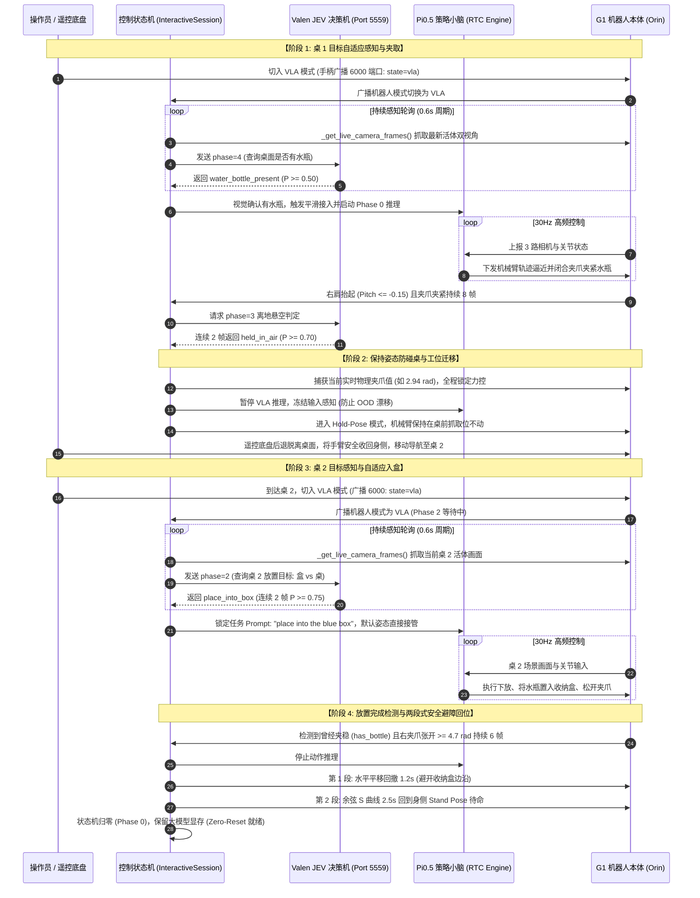

# Unitree G1 Dex-1 具身智能闭环系统技术手册
# (VLA 策略训练与部署 + Valen JEV 多模态决策 + NAV 移动导航协同)

> **文档版本**: v1.0 (Enterprise Comprehensive Edition)  
> **更新时间**: 2026-10-09  
> **适用机型**: Unitree G1 人形机器人（Dex-1 双臂 14-DoF + 双夹爪 2-DoF）  
> **核心组件**: Physical Intelligence $\pi_{0.5}$ (VLA) + Valen JEV Qwen3.5-2B (VLM 决策) + NAV 底盘移动导航  

---

## 目录

- [第 1 章 系统整体架构与协同全景](#第-1-章-系统整体架构与协同全景)
  - [1.1 系统设计哲学与分层控制架构](#11-系统设计哲学与分层控制架构)
  - [1.2 硬件拓扑、主机分工与通信网络矩阵](#12-硬件拓扑主机分工与通信网络矩阵)
  - [1.3 三元协同闭环时序全景图](#13-三元协同闭环时序全景图)
- [第 2 章 VLA 具身操作策略：从数据采集到实机部署全流程](#第-2-章-vla-具身操作策略从数据采集到实机部署全流程)
  - [2.1 遥操作实机数据采集 SOP (Data Collection)](#21-遥操作实机数据采集-sop-data-collection)
    - [2.1.1 遥操作技术选型对比 (Sonic WBC vs xr_teleoperate) 与量化评估](#211-遥操作技术选型对比-sonic-wbc-vs-xr_teleoperate-与量化评估)
    - [2.1.2 宇树官方 xr_teleoperate 硬件拓扑与串流架构](#212-宇树官方-xr_teleoperate-硬件拓扑与串流架构)
    - [2.1.3 多终端规范启动序列与采集 SOP](#213-多终端规范启动序列与采集-sop)
    - [2.1.4 录制交互规范与状态指示反馈](#214-录制交互规范与状态指示反馈)
    - [2.1.5 Dex-1 特征维度与数据结构规范](#215-dex-1-特征维度与数据结构规范)
  - [2.2 数据清洗、动力学处理与子任务切分 (Data Processing)](#22-数据清洗动力学处理与子任务切分-data-processing)
    - [2.2.1 异常样本剔除与数据质量治理](#221-异常样本剔除与数据质量治理)
    - [2.2.2 原地转身与下肢动力学速度对齐](#222-原地转身与下肢动力学速度对齐)
    - [2.2.3 双子任务切分的深层意义与 Valen JEV 联动机制](#223-双子任务切分的深层意义与-valen-jev-联动机制)
    - [2.2.4 LeRobotDataset 格式自检与产物规范](#224-lerobotdataset-格式自检与产物规范)
  - [2.3 Pi0.5 策略模型与 LoRA 微调训练 (LoRA Fine-tuning)](#23-pi05-策略模型与-lora-微调训练-lora-fine-tuning)
    - [2.3.1 模型训练演进历程：双手抱箱到 Dex-1 夹水瓶的技术跃迁](#231-模型训练演进历程双手抱箱到-dex-1-夹水瓶的技术跃迁)
    - [2.3.2 Pi0.5 骨干网络与 DiT Action Expert 架构](#232-pi05-骨干网络与-dit-action-expert-架构)
    - [2.3.3 LoRA 微调参数设计与模块适配法则](#233-lora-微调参数设计与模块适配法则)
    - [2.3.4 训练超参数与配置清单 (`train_pi05_dex1_subtasks_config.yaml`)](#234-训练超参数与配置清单-train_pi05_dex1_subtasks_configyaml)
    - [2.3.5 权重合并与部署模型导出 (`merged_model`)](#235-权重合并与部署模型导出-merged_model)
  - [2.4 VLA 实机部署与 RTC 异步控制流水线 (VLA Rollout)](#24-vla-实机部署与-rtc-异步控制流水线-vla-rollout)
    - [2.4.1 RTC (Real-Time Chunking) 异步架构原理](#241-rtc-real-time-chunking-异步架构原理)
    - [2.4.2 动作分发、夹爪映射与介入平滑 (Engagement Smoothing)](#242-动作分发夹爪映射与介入平滑-engagement-smoothing)
- [第 3 章 Valen JEV 多模态决策系统的接入与部署](#第-3-章-valen-jev-多模态决策系统的接入与部署)
  - [3.1 JEV 原理与轻量级 VLM 服务端部署](#31-jev-原理与轻量级-vlm-服务端部署)
  - [3.2 双视角画面水平拼接与多工位 Criteria 条件协议](#32-双视角画面水平拼接与多工位-criteria-条件协议)
  - [3.3 实时活体画面直通采集机制 (`_get_live_camera_frames`)](#33-实时活体画面直通采集机制-_get_live_camera_frames)
  - [3.4 电平驱动持续感知轮询 (Level-Triggered Polling) 与目标自适应触发](#34-电平驱动持续感知轮询-level-triggered-polling-与目标自适应触发)
  - [3.5 视觉与动力学双重门禁设计 (防夹空与防早停)](#35-视觉与动力学双重门禁设计-防夹空与防早停)
- [第 4 章 NAV 移动导航与工位迁移系统 (框架规范)](#第-4-章-nav-移动导航与工位迁移系统-框架规范)
  - [4.1 移动导航在跨工位搬运中的角色定位](#41-移动导航在跨工位搬运中的角色定位)
  - [4.2 导航期间的上肢姿态解耦与物理防脱安全锁](#42-导航期间的上肢姿态解耦与物理防脱安全锁)
  - [4.3 底盘控制接口与到达信号交互契约 (预留待补)](#43-底盘控制接口与到达信号交互契约-预留待补)
- [第 5 章 全流程状态机流转与多轮实验闭环控制](#第-5-章-全流程状态机流转与多轮实验闭环控制)
  - [5.1 跨桌全任务状态机流转矩阵 (Phase 0 ~ Phase 4)](#51-跨桌全任务状态机流转矩阵-phase-0--phase-4)
  - [5.2 抓取位保持防碰桌模式 (Hold-Pose Transfer Mode) 机制](#52-抓取位保持防碰桌模式-hold-pose-transfer-mode-机制)
  - [5.3 两段式避障平滑回位 (Safe Homing)](#53-两段式避障平滑回位-safe-homing)
  - [5.4 彻底重置机制 (Clean Reset，按 'r') 与 Phase 初始状态完全恢复](#54-彻底重置机制-clean-reset按-r-与-phase-初始状态完全恢复)
  - [5.5 零显存重载多轮闭环实验 (Zero-Reset Loop)](#55-零显存重载多轮闭环实验-zero-reset-loop)
- [第 6 章 实机部署操作 SOP 与运维排错指南 (FAQ)](#第-6-章-实机部署操作-sop-与运维排错指南-faq)
  - [6.1 实机部署多终端一键启动命令](#61-实机部署多终端一键启动命令)
  - [6.2 操作员交互指令与控制台 HUD 速查](#62-操作员交互指令与控制台-hud-速查)
  - [6.3 常见故障排查手册 (Troubleshooting)](#63-常见故障排查手册-troubleshooting)
  - [6.4 全程无感高精度录制与数据自检 (Whole-Session Recorder)](#64-全程无感高精度录制与数据自检-whole-session-recorder)
  - [6.5 图形化控制台与多机监控前端 (PySide6 VLA Viewer)](#65-图形化控制台与多机监控前端-pyside6-vla-viewer)

---

## 第 1 章 系统整体架构与协同全景

### 1.1 系统设计哲学与分层控制架构

在具身双臂人形机器人的长程移动操作（Mobile Manipulation）任务中，如果直接使用单一端到端 VLA（Vision-Language-Action）模型贯穿全流程，面临着两大根本性物理瓶颈：
1. **分布外灾难漂移（OOD Drift）**：底盘移动、行走颠簸及长距离转场视野剧烈变化，端到端策略模型受累积误差影响极易发散，导致执行机构在非工位期间输出不可控动作；
2. **算力与频率不匹配**：精细双臂操作需要高频闭环（~30Hz），而长程决策与全局目标研判属于低频语义推理（1~3Hz）。

为此，本系统构建了**高低频解耦、感知-决策-运控三位一体的分层混合具身架构（Hierarchical Embodied Architecture）**：

```
                      ┌────────────────────────────────────────────────────────┐
                      │              顶层决策大脑 (System-2 / JEV)              │
                      │         Valen JEV (Qwen3.5-2B, 2~4Hz, ZMQ 5559)        │
                      │  • 桌1水瓶感知  • 离地悬空判定  • 桌2容器识别  • 放置后验确认 │
                      └───────────────────────────┬────────────────────────────┘
                                                  │ 异步语义裁决 (JSON)
                                                  ▼
┌────────────────────────────────────────────────────────────────────────────────────────────────┐
│                           核心流转中枢 (Interactive Rollout Controller)                          │
│                                (Phase 0 ~ Phase 4 核心状态机)                                   │
│  • 6000 模式自动响应  • 电平轮询调度  • 实时夹爪力锁定  • 冻结姿态恢复  • 两段式避障回位  • Clean Reset   │
└───────────────────────┬────────────────────────────────────────────────┬───────────────────────┘
                        │                                                │
       高频双臂精细操作指令 (~30Hz)                                     工位间长距离物理转场
                        ▼                                                ▼
┌──────────────────────────────────────────────┐ ┌──────────────────────────────────────────────┐
│           具身小脑 (System-1 / VLA)           │ │              移动底盘 (Locomotion / NAV)       │
│           Pi0.5 Policy (RTC 异步推理)         │ │            G1 自主导航 / 手柄底盘运动系统      │
│  • 3 路相机输入 (224x224x3 @ 30fps)          │ │  • 工位间远距离移动 (桌 A ↔ 桌 B)            │
│  • 16-DoF 关节与夹爪实时插值轨迹下发          │ │  • 导航期间上肢姿态冻结，规避 OOD 抖动干扰    │
└──────────────────────────────────────────────┘ └──────────────────────────────────────────────┘
```

- **感知与裁决大脑 (Valen JEV)**：负责低频宏观环境判别（桌面是否有物体、是否夹稳悬空、目标是箱子还是桌子、放置是否成功）。
- **具身操作小脑 (Pi0.5 VLA)**：专精于工作台前厘米级的精密接触操作（逼近、触碰、夹紧、抬起、对准、入盒松开）。
- **工位移动载体 (NAV)**：负责工位间的长距离安全物理移动，在移动期间上肢动作与视觉输入完全冻结，阻断外界颠簸对 VLA 的冲击。

---

### 1.2 硬件拓扑、主机分工与通信网络矩阵

系统由三台物理计算节点构成高速局域网络互联：

```
┌───────────────────────────────────────────────────────────────────────────────────────────────┐
│ 节点 1: 机器人机载端 (Jetson Orin, IP: 10.3.42.221)                                           │
│   ├─ 视觉推流 (robot_server/camera_server/server.py):                                         │
│   │    • 5555/5556: 全局头部相机 (base_0_rgb, 640x480 @ 30fps)                               │
│   │    • 5557: 左手腕特写相机 (left_wrist_0_rgb, 640x480 @ 30fps)                             │
│   │    • 5558: 右手腕特写相机 (right_wrist_0_rgb, 640x480 @ 30fps)                            │
│   └─ 电机桥接 (robot_server/camera_server/motor_server.py):                                   │
│        • Port 6000 (ZMQ PULL): 接收上位机发出的关节目标角与模式联动心跳 (`{"state":"vla"}`)    │
│        • Port 6001 (ZMQ PUB):  实时广播 29-DoF 关节编码器反馈与机器人当前运行模式              │
│        • CycloneDDS:           底层对接 Unitree 原厂电机驱动                                 │
└─────────────────────────────────▲───────────────────────────────────────▲─────────────────────┘
                                  │                                       │
                      千兆以太网 (ZMQ 视频/状态)                千兆以太网 (ZMQ 动作控制)
                                  │                                       │
┌─────────────────────────────────▼───────────────────────────────────────▼─────────────────────┐
│ 节点 2: 上位机控制工作站 (GPU Host / RTX 4090/5090, IP: 192.168.123.213)                      │
│   ├─ 控制主进程: run_vla_water_bottle_transfer_hold.py                                        │
│   │    • 状态机中枢: InteractiveSession (Phase 0 ~ Phase 4 全自动状态流转)                    │
│   │    • 策略执行器: RolloutController (RTC 异步推理流水线，Chunk Size 50，30Hz)              │
│   │    • 硬件驱动层: UnitreeG1ClientWrapper (电机状态监听与双向转换)                         │
│   └─ 遥操数据采集系统 (数据采集阶段使用):                                                     │
│        • 宇树官方遥操作服务: xr_teleoperate/teleop_hand_and_arm.py (Port 6001/6002/6004)     │
│        • WebXR 空间交互代理: vuer.ai (接收 PICO 4 VR 手柄位姿并驱动 Dex-1 夹爪)                │
│        • (注: 早期探索的 SonicStar C++ WBC 方案因动作抖动大且与状态偏差严重已弃用)             │
└───────────────────────────────────────────────────▲───────────────────────────────────────────┘
                                                    │
                                        局域网 ZMQ (JSON + JPEG 单图)
                                                    │
┌───────────────────────────────────────────────────▼───────────────────────────────────────────┐
│ 节点 3: 远端视觉决策机 (Valen JEV Host, IP: 0.0.0.0 / 10.8.8.98, Port: 5559)                 │
│   └─ 决策服务: valen/scripts/valen_remote_service.py                                          │
│        • 视觉语言大模型: Qwen3.5-2B + 离散分类头 (Softmax 概率分布)                          │
│        • 双图拼接预处理: 全局图 (448x448) + 右腕图 (448x448) -> 896x448 单张 RGB              │
│        • 推理耗时: 单次约 200 ~ 300 ms                                                        │
└───────────────────────────────────────────────────────────────────────────────────────────────┘
```

#### 系统核心端口与通信矩阵清单

| 端口号 | 传输协议 | 发送方 (Sender) | 接收方 (Receiver) | 数据载荷与业务功能 |
| :--- | :--- | :--- | :--- | :--- |
| **5555 / 5556** | ZMQ PUB/SUB | 机载 Orin (`server.py`) | 上位机工作站 | 全局主摄 RGB 视频流（JPEG base64，`base_0_rgb`） |
| **5557** | ZMQ PUB/SUB | 机载 Orin (`server.py`) | 上位机工作站 | 左手腕特写相机 RGB 视频流（`left_wrist_0_rgb`） |
| **5558** | ZMQ PUB/SUB | 机载 Orin (`server.py`) | 上位机工作站 | 右手腕特写相机 RGB 视频流（`right_wrist_0_rgb`） |
| **6000** | ZMQ PULL/PUSH | 上位机工作站 | 机载 Orin (`motor_server.py`) | 目标关节位置指令下发，及底盘模式广播（`{"state":"vla"}`） |
| **6001** | ZMQ PUB/SUB | 机载 Orin (`motor_server.py`) | 上位机工作站 | 关节真实物理角度、角速度、力矩及机载状态广播 |
| **5559** | ZMQ REQ/REP | 上位机工作站 (`valen_client`) | 远端决策机 (`valen_service`) | 双图拼接图像 (JPEG) + 阶段配置 (JSON) ↔ 选项分布结果 |

---

### 1.3 三元协同闭环时序全景图

整个长程搬运任务中，JEV、VLA 与 NAV 三者紧密协作，时序流转如下：



---

## 第 2 章 VLA 具身操作策略：从数据采集到实机部署全流程

### 2.1 遥操作实机数据采集 SOP (Data Collection)

#### 2.1.1 遥操作技术选型对比 (Sonic WBC vs xr_teleoperate) 与量化评估

在项目启动与推进过程中，团队针对 Unitree G1 机械臂探索并深入测试了两套遥操作数据采集方案：
1. **方案 A：基于 SonicStar (GEAR-SONIC C++ WBC) 的初期探索**；
2. **方案 B：基于宇树原厂 `xr_teleoperate` (Teleop Hand & Arm) 的最终落地方案**。

##### 1. SonicStar WBC 方案的严重缺陷机理与量化评估

在早期实验中，系统采用 PICO 4 VR 结合 SonicStar 的 C++ WBC 控制器（`gear_sonic_deploy`）求解双臂逆运动学，并通过 `run_data_exporter.py` 进行数据落盘。但在深入分析采集数据并使用策略模型回放实测后发现，该方案存在致命的底层质量缺陷，导致模型学习后在实机上表现出严重的动作高频振颤、电机尖锐啸叫甚至轨迹发散。

运行专用评测工具 [`evaluate_state_action.py`](file:///home/yichangfeng/lerobot/dataset_tools/evaluate_state_action.py)，对采集数据进行全维度横向比对，其量化评估结果集中呈现于 [`evaluation_plots_ik_vs_sonic/`](file:///home/yichangfeng/lerobot/evaluation_plots_ik_vs_sonic/) 的 6 张学术级分析图表中：

- **图 1：Action 抖动 vs State 抖动对比 ([`eval_1_jitter_comparison.png`](file:///home/yichangfeng/lerobot/evaluation_plots_ik_vs_sonic/eval_1_jitter_comparison.png))**：
  采用二阶有限差分度量离散角加速度抖动 $\text{Jitter}_t = |q_{t+1} - 2q_t + q_{t-1}|$。时域波形清晰显示，真实物理关节角 $\text{State}$ 保持在平滑基线（均值仅 $0.00124 \text{ rad} = 1.24 \text{ mrad}$），而控制指令 $\text{Action}$ 呈现出密集的剧烈锯齿波，各关节抖动均值飙升至 **$0.01201 \text{ rad} = 12.01 \text{ mrad}$**。左肩侧摆放大 **9.8x**，手肘放大 **8.6x**，手腕部分自由度甚至放大达 **12.5x ~ 15x**！
- **图 2：Action 与 State 位置偏差与动力学跟踪失真 ([`eval_2_position_discrepancy.png`](file:///home/yichangfeng/lerobot/evaluation_plots_ik_vs_sonic/eval_2_position_discrepancy.png))**：
  偏差定义为 $\Delta q(t) = q_{\text{action}}(t) - q_{\text{state}}(t)$。在操作过程中，$\text{Action}$ 与 $\text{State}$ 发生了严重的非线性极值漂移，误差标准差高达 $13.8^\circ$。在保持位姿与任务末尾阶段，期望位置与物理状态大幅脱节，给底层驱动带来了极不稳定的阶跃冲击。
- **图 3：跨数据集单回合横向指标对比 ([`eval_3_cross_dataset_comparison.png`](file:///home/yichangfeng/lerobot/evaluation_plots_ik_vs_sonic/eval_3_cross_dataset_comparison.png))**：
  对比开源成熟平滑数据集，Sonic WBC 数据的 Action 平均抖动高达开源数据的 **6.16 倍**；抖动膨胀比率（Action/State Ratio）高达 **9.70x ~ 13.1x**，而平滑基准仅为 **1.34x ~ 1.1x**。
- **图 4 & 图 5：全数据集统计与各关节对比 ([`eval_4_open_jitter_comparison.png`](file:///home/yichangfeng/lerobot/evaluation_plots_ik_vs_sonic/eval_4_open_jitter_comparison.png), [`eval_5_dataset_wide_comparison.png`](file:///home/yichangfeng/lerobot/evaluation_plots_ik_vs_sonic/eval_5_dataset_wide_comparison.png))**：
  在多回合全数据集统计下，双臂全部 14 个关节的 Action 抖动和跟踪 MAE 全面大幅恶化，且存在显著的动作时延滞后。
- **图 6：频域功率谱密度 (PSD) 分析 ([`eval_6_frequency_spectrum.png`](file:///home/yichangfeng/lerobot/evaluation_plots_ik_vs_sonic/eval_6_frequency_spectrum.png))**：
  傅里叶频域功率谱分析证实，Sonic WBC 输出的 Action 在 $>3\text{Hz}$ 的高频频段存在巨大的异常能量峰值。物理机器人由于连杆质量、转动惯量与速度阻尼，天然滤除了高频抖动（从而表现出 State 平滑），但数据集中记录的 Action 却将未过滤的高频噪声全盘吸收。

**缺陷根因机理剖析**：
1. **光学追踪遮挡与噪声跳变**：操作员双手在身前操作时，手柄光学标记被遮挡，VR 算法在红外校准与 IMU 积分间剧烈跳变；
2. **IK 求解的非线性几何放大**：C++ WBC 逆运动学在机械臂近前伸构型或接近奇异值（Singularity）边缘时，雅可比伪逆矩阵条件数恶化，末端毫米级微动被数学放大为关节空间的剧烈阶跃；
3. **因果脱节导致模仿学习崩溃**：策略模型强行拟合高频剧烈抖动的 Action，实机推理输出的轨迹必然伴随强烈抽搐与机械振颤。

##### 2. 最终选型：宇树官方 `xr_teleoperate` 方案

鉴于 SonicStar 方案无法满足高精度具身操作的数据质量要求，团队果断放弃 Sonic WBC，全面切换为**宇树官方 `xr_teleoperate`** 遥操作平台：
- **精确运动学适配**：宇树原厂 IK 算法深度贴合 G1 刚体骨架与关节限位，彻底消除了雅可比奇异放大；
- **余弦 S 曲线平滑介入 (Engagement Smoothing)**：原生内置 `--smooth-duration 2.0` 平滑介入逻辑，机械臂以余弦 S 曲线平缓接入 VR 手柄追踪，杜绝开机甩臂与突跳；
- **原生支持 Dex-1 夹爪闭环控制**：通过 DDS 与机载 `dex1_1_service` 通信，实现 `[2.7, 5.0]` rad 安全量程内的非对称开闭控制（开爪步长 0.15，闭爪步长 0.08），夹爪开合指令与物理反馈严丝合缝；
- **Action 与 State 高度对齐**：二阶抖动膨胀比收敛至近 1.0，彻底消除高频噪声，为下游模型训练提供了坚实干净的数据底座。

---

#### 2.1.2 宇树官方 xr_teleoperate 硬件拓扑与串流架构

系统通过高速局域网络实现机载相机推流、低层 DDS 运控及 WebXR 沉浸式串流：

```
┌────────────────────────────────────────────────────────────────────────┐
│  机器人机载端 PC2 (192.168.123.164 / 10.3.42.221)                      │
│                                                                        │
│  ┌──────────────┐  ┌──────────────┐  ┌──────────────┐                  │
│  │ 头部 RealSense │  │ 左腕部相机   │  │ 右腕部相机   │                  │
│  │ D435i        │  │ (JR0002)     │  │ (JR0001)     │                  │
│  └──────┬───────┘  └──────┬───────┘  └──────┬───────┘                  │
│         └────────┬────────┴────────┬────────┘                          │
│                  ▼                 ▼                                   │
│            teleimager 图像推流服务 (image_server)                       │
│            ZMQ PUB :55555 (头)  :55556 (左腕)  :55557 (右腕)           │
│                                                                        │
│  ┌──────────────────────────────┐                                      │
│  │ dex1_1_service 夹爪驱动服务  │                                      │
│  │ DDS: rt/dex1/{left,right}/   │                                      │
│  │     {cmd, state}             │                                      │
│  └──────────────────────────────┘                                      │
└─────────────────────────────────┬──────────────────────────────────────┘
                                  │ 千兆以太网 (ZMQ 视频 / DDS 运控)
                                  ▼
┌────────────────────────────────────────────────────────────────────────┐
│  上位机 Host (GPU 工作站, 192.168.123.213)                              │
│                                                                        │
│  teleop_hand_and_arm.py (conda: tv)                                    │
│  ├─ ImageClient: 接收 55555/55556/55557 三路 30FPS 图像流              │
│  ├─ G1_29_ArmController: 14 关节运动学求解与 DDS 指令下发              │
│  ├─ Dex1_1_Gripper_Controller: 双夹爪平滑闭环控制                      │
│  ├─ TeleVuerWrapper: WebXR 代理 (Port 8012) 接收手柄 6-DoF 空间位姿    │
│  └─ EpisodeWriter: 异步落盘数据 (Parquet 表格 + MP4 视频)              │
└─────────────────────────────────┬──────────────────────────────────────┘
                                  │ WiFi 局域网 (WebXR 协议)
                                  ▼
                        ┌──────────────────┐
                        │   PICO 4 Ultra   │
                        │    (XR 头显)     │
                        └──────────────────┘
```

---

#### 2.1.3 多终端规范启动序列与采集 SOP

严格按照以下顺序执行启动：

##### 【终端 0】(机载 PC2 SSH) 启动三路图像推流与 Dex1 夹爪服务
```bash
ssh unitree@192.168.123.164
# 密码默认: 123

# 1. 启动三路相机推流服务
cd ~/xr_teleoperate/teleop/teleimager
source ~/teleimager/env_teleimager/bin/activate
python3 -m teleimager.image_server --rs
```
*验证标志*：打印 `[Image Server] head_camera is ready.`，`left_wrist_camera is ready.`，`right_wrist_camera is ready.`。
若另开终端，确认 `dex1_1_service` 服务处于就绪状态，DDS topic `rt/dex1/*/state` 有正常心跳。

##### 【终端 1】(上位机工作站) 启动官方 xr_teleoperate 遥控与数据记录
```bash
conda activate tv
cd /home/yichangfeng/xr_teleoperate/teleop

python teleop_hand_and_arm.py \
  --arm G1_29 \
  --ee dex1 \
  --input-mode controller \
  --use-zmq \
  --robot-ip 192.168.123.164 \
  --zmq-state-port 6001 \
  --zmq-action-port 6002 \
  --zmq-gripper-port 6004 \
  --smooth-duration 2.0 \
  --gripper-min 2.7 \
  --gripper-max 5.0 \
  --gripper-open-step 0.15 \
  --gripper-close-step 0.08 \
  --record \
  --task-name "g1_pick_put_dex1"
```
*验证标志*：打印 `[G1_29_ArmController] Subscribe dds ok.`，`EpisodeWriter initialized successfully.`，`🟢 Press [r] (or Pico Right [A]) to start syncing...`。

##### 【终端 2】(PICO 4 Ultra 头显) 佩戴并进入全沉浸 VR
1. 佩戴 PICO 头显，确保与上位机处于同一低延迟 5G WiFi 局域网；
2. 打开内置浏览器，访问 `https://vuer.ai?ws=wss://192.168.123.213:8012`；
3. 点击页面右下角 **"Virtual Reality"** 按钮，进入全屏沉浸式遥操作工作区。

---

#### 2.1.4 录制交互规范与状态指示反馈

遥操作交互通过 PICO 控制手柄按键与上位机彩色 ANSI 控制台紧密配合，实现零停顿高效采集：

| 操作按键 | 执行功能 | 系统行为与反馈机制 |
| :--- | :--- | :--- |
| **右手 A 键** | **开始同步 / 恢复追踪** | 触发余弦 S 曲线（2.0s），手臂平滑自当前姿态过渡至追踪位，无突跳 |
| **左 Grip + 右 A** | **开始录制当前 Episode** | 控制台打印 `● [START RECORDING | EP#X]`，图像与动力学数据以 30Hz 压入缓冲区 |
| **左 Grip + 右 B** | **结束并保存当前 Episode** | 控制台打印 `[STOP RECORDING] -> [SAVED]`，数据落盘并生成标准视频 |
| **左手摇杆** | **底盘移动控制** | 前推/后拉控制前进后退速度 $v_x$，左右推动控制横移 $v_y$（限速 $0.3\text{ m/s}$） |
| **右手摇杆** | **底盘转向控制** | 左右推压控制底盘旋转偏航角速度 $v_{\text{yaw}}$（限速 $0.3\text{ rad/s}$） |
| **右手 A + 左手 X** | **双臂平滑回零** | 自动保存当前片段，双臂以 S 曲线平稳收回初始预备待命姿态 |
| **双摇杆同时按下** | **硬件紧急阻尼 (Damp)** | 机器人底盘与手臂瞬间进入全阻尼保护模式，软急停避险 |

---

#### 2.1.5 Dex-1 特征维度与数据结构规范

在 Dex-1 硬件配置下，`xr_teleoperate` 记录的单帧数据结构严格规范如下：

```python
# 1. 图像特征 (3 路高清相机，30 FPS，统一保存为 H.264 MP4 视频)
"observation.images.cam_high":        [480, 640, 3], uint8  # 头部全局 RealSense
"observation.images.cam_left_wrist":  [480, 640, 3], uint8  # 左手腕相机 (JR0002)
"observation.images.cam_right_wrist": [480, 640, 3], uint8  # 右手腕相机 (JR0001)

# 2. 状态特征 (observation.state, 31 维 float64)
#   [0:12]   双腿 12 关节真实物理弧度 (左腿 6 + 右腿 6)
#   [12:15]  腰部 3 关节 (Yaw, Roll, Pitch)
#   [15:22]  左臂 7 关节实际弧度 (Shoulder P/R/Y, Elbow, Wrist R/P/Y)
#   [22:29]  右臂 7 关节实际弧度 (Shoulder P/R/Y, Elbow, Wrist R/P/Y)
#   [29:30]  左 Dex-1 夹爪实测闭合角 (2.7 ~ 5.0 rad)
#   [30:31]  右 Dex-1 夹爪实测闭合角 (2.7 ~ 5.0 rad)

# 3. 动作特征 (action, 20 维 float64)
#   [0:7]    左臂 7 关节目标弧度
#   [7:14]   右臂 7 关节目标弧度
#   [14:15]  左 Dex-1 夹爪目标指令 (2.7 闭 ~ 5.0 开)
#   [15:16]  右 Dex-1 夹爪目标指令 (2.7 闭 ~ 5.0 开)
#   [16:20]  底盘遥控速度 (remote.lx, remote.ly, remote.rx, remote.ry)
```

---

### 2.2 数据清洗、动力学处理与子任务切分 (Data Processing)

#### 2.2.1 异常样本剔除与数据质量治理
在完成批量遥操采集后，必须通过专用工具 [`sanitize_sonic_dataset.py`](file:///home/yichangfeng/lerobot/dataset_tools/sanitize_sonic_dataset.py) 执行质量治理：
1. **剔除坏样**：对于操作过程中掉瓶、滑脱或机械臂剧烈抖动的 Episode，直接剔除：
   ```bash
   python ~/lerobot/dataset_tools/sanitize_sonic_dataset.py --delete-episodes 4 12 28
   ```
2. **裁剪静止等待期**：遥操启动瞬间往往有 2~5 秒准备期，机械臂原地未动。此无意义静止帧会导致模型学到“发呆”统计偏差，使用 `--trim-start` 将动作启动前的无效等待精准裁剪：
   ```bash
   python ~/lerobot/dataset_tools/sanitize_sonic_dataset.py --trim-start 0:3.2 1:4.0
   ```

#### 2.2.2 原地转身与下肢动力学速度对齐
若采集的数据涉及下肢原地踏步转向（如从桌 A 转体面向桌 B），在动作空间中包含底盘角速度。底模 `model/pi05_base` 采用 **QUANTILES**（分位数 $q_{01} \sim q_{99}$）进行动作归一化。
当平移速度恒为 0（`lx=0, ly=0`）时，直接统计会导致分母 $q_{99} - q_{01} = 0$ 塌陷，引发除零异常。必须运行速度对齐工具 [`align_velocity_dataset.py`](file:///home/yichangfeng/lerobot/dataset_tools/align_velocity_dataset.py)：
```bash
python dataset_tools/align_velocity_dataset.py \
    --src-dir datasets/g1_pick_put_dex1_raw \
    --dst-dir datasets/g1_pick_put_dex1_aligned
```
该工具将静止动作空间严格对齐至基座模型预训练的零偏置点，消除数值震荡。

#### 2.2.3 双子任务切分的深层意义与 Valen JEV 联动机制

为实现机器人自主、智能、双向的长程作业，必须将数据集中连续往返的长轨迹精准切分为两个带明确语言指令的子任务（Subtasks）：
- **Subtask 0**: `"pick up the water bottle from the table and place it into the blue box"`（桌取水瓶并放入收纳盒）
- **Subtask 1**: `"take the water bottle out of the blue box and place it back on the table"`（从收纳盒取出水瓶并放回桌面）

切分子任务不仅是一道数据预处理工序，更是**支撑整个系统高低频解耦与闭环决策的核心理论与工程基石**：

##### 1. 打破固定轨迹机械背诵，破除因果混淆 (Causal Confusion)
- **单一长轨迹的弊端**：若将“桌上拿水入盒”与“盒中取水回放”拼合为一个长达数十秒的连续轨迹，并施加单一粗粒度指令（如 `"pick up bottle and return"`），策略在模仿学习（行为克隆）下只能强行死记硬背整套动作的时间戳序列。在实机闭环控制中，由于开环时间先验过重，模型极易出现**因果混淆**（例如瓶子还没抓牢就因为步数推移提前做出回撤放手动作；或者在碰触障碍时完全丧失自我纠偏能力）。
- **解耦为双向可组合技能基元**：通过物理切分，将单条长程示范解耦为两组功能高度独立、具有清晰起止边界与语义指向的技能基元。策略模型分别拟合并掌握了“逼近桌瓶 $\to$ 夹紧 $\to$ 抬起 $\to$ 入盒松开”以及“探入盒内 $\to$ 夹取 $\to$ 抬高 $\to$ 桌面放置”两套双向互逆的泛化能力。

##### 2. 为接入 Valen JEV 多模态决策提供必要的前提与语义抓手
- **顶层大脑与底层小脑的协同契约**：Valen JEV（System-2）作为高阶评判大脑，负责根据现场活体画面判断当前世界状态（如 Phase 4 判定桌 1 上是否有水瓶；Phase 3 判定是否稳固离地悬空；Phase 2 判定桌 2 上是收纳盒还是空桌面；Phase 0 判定放瓶入盒是否完成）。
- **动态调度必须依赖明确的 Prompt 接口**：JEV 做出的所有语义裁决，最终必须通过**分发不同 Prompt 注入具身小脑（Pi0.5 VLA）**来驱动物理执行：
  - 当 JEV 在桌 1 观察到桌上有水瓶时，状态机立即激活 **Subtask 0**（`"pick up the water bottle from the table and place it into the blue box"`），驱动机械臂执行逼近与入盒；
  - 当未来需要从盒子中取回水瓶或在桌 2 逆向作业时，调度中心根据 JEV 判断无缝将 Prompt 切换为 **Subtask 1**（`"take the water bottle out of the blue box and place it back on the table"`），驱动机械臂从盒子中掏出水瓶平稳放回桌面；
  - **若没有子任务切分**，底层策略只有一个模糊固化的单一长 Prompt，则上层 JEV 无论给出何种精细的环境研判，底层都无法分阶段响应，三元闭环协同将彻底失去语义抓手！

##### 3. 高效率无损切分注入技术实现 (`apply_dex1_subtask_cut.py`)
使用专用切分注入脚本 [`apply_dex1_subtask_cut.py`](file:///home/yichangfeng/lerobot/dataset_tools/apply_dex1_subtask_cut.py)：
```bash
python dataset_tools/apply_dex1_subtask_cut.py \
    --records-file /home/yichangfeng/xr_teleoperate/teleop/utils/data/g1_pick_put_dex1/subtask_cut_records.json \
    --src-dir datasets/g1_pick_put_dex1_0923 \
    --dst-dir datasets/g1_pick_put_dex1_0923_subtasks
```

**切分核心技术特色**：
1. **零磁盘开销软链接（Zero-Copy Symlink）**：三路相机录制的大容量 MP4 视频采用软链接直接映射至新数据集目录，几秒内即可完成全量数据的构建，不占用额外硬盘存储；
2. **逐帧打标（Per-frame Task Index）**：在 Parquet 数据文件中为每一帧精准打上 `task_index = 0` 或 `task_index = 1`；
3. **元数据全量对齐**：同步更新 `meta/tasks.parquet`、`meta/info.json` 与 `meta/stats.json`，确保 LeRobot 训练器与 Tokenizer 原生识别多任务多 Prompt。

#### 2.2.4 LeRobotDataset 格式自检与产物规范
转化完成后，数据集目录结构如下：
```text
datasets/g1_pick_put_dex1_0923_subtasks/
├── data/
│   └── chunk-000/
│       ├── episode_000000.parquet
│       └── ...
├── meta/
│   ├── episodes/
│   ├── info.json          # 记录 fps(30), 样本总数, 特征字典定义
│   ├── stats.json         # 动作与状态的 min, max, mean, std, q01, q99 统计量
│   └── tasks.parquet      # 包含 Subtask 0 和 Subtask 1 的语言文本定义
└── videos/
    └── chunk-000/
        ├── observation.images.cam_high/
        ├── observation.images.cam_left_wrist/
        └── observation.images.cam_right_wrist/
```
通过自检脚本验证数据完整性：
```bash
python -c "from lerobot.datasets.lerobot_dataset import LeRobotDataset; ds = LeRobotDataset('datasets/g1_pick_put_dex1_0923_subtasks'); print(f'Dataset valid: {len(ds)} frames, {ds.num_episodes} episodes')"
```

---

### 2.3 Pi0.5 策略模型与 LoRA 微调训练 (LoRA Fine-tuning)

#### 2.3.1 模型训练演进历程：双手抱箱到 Dex-1 夹水瓶的技术跃迁

在达到当前稳定闭环之前，团队经历了从“双手抱箱动作头微调”到“双手抱箱 LoRA 微调”，最终跃迁至“Dex-1 夹爪夹水瓶 Pi0.5 原生底模 LoRA”的完整技术演进路径：

```
【阶段 1: 双手抱箱 + 仅微调动作头】
  • 基模: model/unitree_box_move (G1 抱箱开源检查点)
  • 方式: train_expert_only=true (冻结 PaliGemma VLM，仅调 300M Action Expert)
  • 表现: 效果差！Arm MAE 达 3°~5°，策略过度依赖本体关节状态(占70%)，视觉无响应。
          │
          ▼
【阶段 2: 双手抱箱 + 全链路 LoRA 微调】
  • 方式: peft: LORA (r=64, alpha=128，全链路覆盖 VLM 与 DiT)
  • 表现: 离线指标大幅好转 (Arm MAE 降至 ~0.95°，余弦相似度 0.9989)。
  • 物理瓶颈: 橡胶手无手指，靠挤压摩擦力抱箱，走动转向必滑脱；实机 RTC 闭环前伸停滞死锁。
          │
          ▼
【阶段 3: Dex-1 夹爪夹水瓶 + Pi0.5 原生底模 LoRA 微调 (当前成熟方案)】
  • 基模: model/pi05_base (Physical Intelligence 原生多模态底模)
  • 换装: 硬件换装 Dex-1 夹爪，任务转为夹水瓶并切分双子任务。
  • 成功机理: 
    1. 高度契合 π₀.₅ 原生预训练任务分布 (海量夹爪抓放先验，泛化极佳)；
    2. 夹爪物理刚性闭合，彻底根除掉落风险；
    3. 抓取角全程锁定，天然适配长程底盘导航转场 (NAV)；
    4. 腕部相机视角清晰，完美契合 Valen JEV 离地与入盒高置信度裁决。
```

##### 1. 阶段 1：双手抱箱任务 + 开源预训练模型微调动作头（效果差）
- **实验设置**：针对配备固定橡胶手（Rubber Hand）的 G1 机器人，采用开源的 `model/unitree_box_move`（或 `model/box_pick`，在开源抱箱数据上预微调的权重）。设置 `--policy.train_expert_only=true`，冻结 2B PaliGemma VLM，仅微调 300M Action Expert 动作头。
- **失效机理剖析**：由于冻结了上层视觉语言表征，策略完全无法自适应新环境的光照、背景、相机视场与工作台高度。离线测试中机械臂平均绝对误差较大（Arm MAE 达 $3.19^\circ \sim 5.07^\circ$，详见 `eval_results.md`）。在因果消融实测中，动作对本体关节状态的依赖度高达 **70% 以上**，而视觉依赖度仅为 **10% 左右**。在实机上表现为“闭眼背诵轨迹”，对箱体位置稍有偏移便无法对准。

##### 2. 阶段 2：双手抱箱任务 + 全链路 LoRA 微调（离线指标改善，但物理运控瓶颈难破）
- **实验设置**：引入全链路精细化 LoRA（$r=64, \alpha=128$，精准覆盖 VLM 注意力、MLP 与 DiT 各层）。
- **改善与瓶颈**：全链路 LoRA 使跨模态表征被充分激活，离线指标显著提升（Arm MAE 下降至 **$0.94^\circ \sim 0.96^\circ$**，余弦相似度高达 **0.9989**，详见 `outputs/eval_lora_leaderboard.md`）。然而物理实机部署暴露了无法逾越的物理与控制双重死结：
  - **接触力矩不足与行走掉箱**：橡胶手无任何可动手指关节，双手抱箱必须依赖双臂横向内夹所产生的挤压位置超调（Virtual Penetration）激发法向压力。但在原地踏步转身或移动转场时，下肢步态的自然颠簸极其容易打破静摩擦力平衡，导致箱子打滑坠落；
  - **实机 RTC 闭环前伸停滞死锁**：在实机闭环 RTC（Real-Time Chunking）高频打断重规划下，机器人刚将箱子抱至胸前，由于带载微沉导致读回的本体状态滞留在抱持初态，视觉权重偏低无法纠偏，策略陷入“抱持初态 $\to$ 重新规划回缩 $\to$ 前后微晃”的死锁循环，无法稳定前伸放下（详见 [`G1_Pi05_Pick_Put_Diagnostic_Report.md`](file:///home/yichangfeng/lerobot/G1_Pi05_Pick_Put_Diagnostic_Report.md)）。

##### 3. 阶段 3：Dex-1 夹爪夹水瓶 + Pi0.5 原生底模 LoRA 微调（最佳落地方案）
- **战略跃迁**：团队决定彻底更换硬件构型与任务范式——将终端执行器升级为 **Dex-1 夹爪**，并将作业对象转为**矿泉水瓶**，底模直接采用 Physical Intelligence 原生基模 **`model/pi05_base`**。
- **飞跃机理与综合优势**：
  - **完美契合 $\pi_{0.5}$ 原生预训练分布**：Physical Intelligence 在预训练 $\pi_0 / \pi_{0.5}$ 时，使用了海量基于平行/双指夹爪进行拾取、放置（Pick-and-Place）的多任务多机型数据。夹爪夹瓶任务与 $\pi_{0.5}$ 底模的结构先验高度一致，模型在逼近瓶身、对齐抓取点与闭合夹爪上展现出卓越的泛化表现；而无指双臂抱箱则属于极端的分布外畸形任务；
  - **几何刚性闭合，杜绝滑脱**：Dex-1 夹爪一旦闭合合拢，即在物理空间上形成刚性几何限位与锁定，彻底摆脱了双手抱箱对不可靠被动摩擦力的依赖；
  - **天然赋能长程导航转场 (NAV Integration)**：水瓶被夹起离地后，控制系统实时采样当前夹爪角度（如 2.94 rad）并全程绝对锁定力控，底盘移动转场时机械臂完全不需要频繁推理或担心物体掉落；
  - **与 Valen JEV 多模态决策无缝闭环**：Dex-1 夹爪手腕相机拥有极佳的俯视特写视野，夹爪是否夹稳瓶身、是否离地悬空（`held_in_air`）、目标是盒还是桌（`place_into_box`）在视觉特征上极其清晰锐利，使得 JEV 的 Softmax 置信度极高（稳定 $\ge 0.70$），彻底激活了全流程闭环状态机。

---

#### 2.3.2 Pi0.5 骨干网络与 DiT Action Expert 架构
$\pi_{0.5}$ (Pi0.5) 继承自 Physical Intelligence 的流匹配（Flow Matching）架构：
- **VLM 视觉语言基座**：基于 PaliGemma-2B，负责将高维 3 视角图像（经过 SigLIP 编码）与多任务文本 Prompt 深度融合，提取富含几何与语义的多模态特征嵌入；
- **DiT Action Expert**：300M 参数的扩散变换器（Diffusion Transformer）作为动作专家，接收 VLM 的 Cross-Attention 引导，在连续动作空间上通过流匹配去噪迭代求解出未来 50 步的连续轨迹 Chunk。

#### 2.3.3 LoRA 微调参数设计与模块适配法则
全参数微调不仅极其消耗显存（需要多张 80GB A100/H100），且容易破坏 VLM 基座原有的空间常识理解。
本系统采用**全链路精细化 LoRA（Low-Rank Adaptation）**方案：
- **秩与缩放系数**：设置 $r=64, \alpha=128$，保障足够的高维表达能力；
- **适配目标层（Target Modules）**：精准覆盖 VLM 注意力投影层、MLP 投影层、Action Expert 注意力层、以及动作输入输出线性层：
  ```regex
  (.*(vision_tower|language_model|gemma_expert).*(q_proj|k_proj|v_proj|o_proj|gate_proj|up_proj|down_proj|fc1|fc2)|.*multi_modal_projector\.linear|model\.(action_in_proj|action_out_proj))
  ```
- **显存与速度优势**：在单张消费级 **RTX 4090 (24GB) 或 RTX 5090 (32GB)** 上即可全速训练，显存稳定占用仅 **8~12 GB**！

#### 2.3.4 训练超参数与配置清单 (`train_pi05_dex1_subtasks_config.yaml`)

完整训练配置文件位于 [`train_pi05_dex1_subtasks_config.yaml`](file:///home/yichangfeng/lerobot/train_pi05_dex1_subtasks_config.yaml)：

```yaml
# 1. 数据集配置
dataset:
  repo_id: "g1_pick_put_dex1_0923_subtasks"
  root: "datasets/g1_pick_put_dex1_0923_subtasks"
  video_backend: "torchcodec"

# 2. 策略模型配置
policy:
  path: "model/pi05_base"
  device: "cuda"
  dtype: "bfloat16"
  gradient_checkpointing: true
  compile_model: false
  push_to_hub: false

# 3. 3 相机输入重命名映射 (对齐 pi0.5 原生 3 视角)
rename_map:
  "observation.images.cam_high": "observation.images.base_0_rgb"
  "observation.images.cam_left_wrist": "observation.images.left_wrist_0_rgb"
  "observation.images.cam_right_wrist": "observation.images.right_wrist_0_rgb"

# 4. 全链路 LoRA 适配器
peft:
  method_type: "LORA"
  r: 64
  lora_alpha: 128
  target_modules: "(.*(vision_tower|language_model|gemma_expert).*(q_proj|k_proj|v_proj|o_proj|gate_proj|up_proj|down_proj|fc1|fc2)|.*multi_modal_projector\\.linear|model\\.(action_in_proj|action_out_proj))"

# 5. 训练调度控制
output_dir: "outputs/train/pi05_lora_5090_g1_pick_put_dex1_subtasks"
job_name: "pi05_lora_5090_g1_pick_put_dex1_subtasks"

batch_size: 8
steps: 10000
num_workers: 4
persistent_workers: true

log_freq: 50
save_freq: 1000
env_eval_freq: 0

# 优化器与余弦退火
use_policy_training_preset: false
optimizer:
  type: "adamw"
  lr: 1.0e-4
  betas: [0.9, 0.95]
  eps: 1.0e-8
  weight_decay: 1.0e-4
  grad_clip_norm: 1.0

scheduler:
  type: "cosine_decay_with_warmup"
  num_warmup_steps: 500
  num_decay_steps: 10000
  peak_lr: 1.0e-4
  decay_lr: 2.0e-5
```

**一键启动微调训练命令**：
```bash
conda activate lerobot
cd ~/lerobot

python -m lerobot.scripts.lerobot_train --config_path train_pi05_dex1_subtasks_config.yaml
```

#### 2.3.5 权重合并与部署模型导出 (`merged_model`)
训练完成后，LoRA 适配器权重以增量方式存储在 `checkpoints/` 下。为了在实机高频控制（30Hz）中达到极致推理速度并消除推理时的 Adapter 前向开销，使用合并脚本将 LoRA 权重融回基座：
```bash
python dataset_tools/merge_lora_weights.py \
    --base-model model/pi05_base \
    --lora-dir outputs/train/pi05_lora_5090_g1_pick_put_dex1_subtasks/checkpoints/last/pretrained_model \
    --output-dir outputs/train/pi05_lora_5090_g1_pick_put_dex1_subtasks/merged_model
```
生成的 `merged_model` 是自包含的标准 Hugging Face 权重目录，包含独立 `config.json` 与 `model.safetensors`，可直接由 `LeRobotPolicy` 原生加载！

---

### 2.4 VLA 实机部署与 RTC 异步控制流水线 (VLA Rollout)

#### 2.4.1 RTC (Real-Time Chunking) 异步架构原理
在真机闭环中，神经网络生成 50 步轨迹（Horizon Chunk）需要约 80~120ms，而下位机电机执行循环需要持续 30Hz（约 33ms 一帧）连续平滑给值。
系统采用 **RTC 异步流水线架构**：
- **推理工作线程 (Worker Thread)**：后台持续以 ~10Hz 轮询最新三路相机图像和当前关节角，异步预测未来的动作 Chunk（$50 \times 16$ 维）；
- **控制发信线程 (Serve Thread)**：严格按照 30Hz 时钟周期运行。从当前生效的 Chunk 中按时间戳取出动作，应用指数加权时间集成（Temporal Ensembling）平滑过滤后，通过 ZMQ 发往 6000 端口。当新 Chunk 计算完成时无缝接替旧 Chunk，彻底消除了计算停顿引发的电机顿挫。

#### 2.4.2 动作分发、夹爪映射与介入平滑 (Engagement Smoothing)

```python
# RTC 控制循环中的动作切分与映射 (src/lerobot/rollout/controller.py)
action_chunk = rtc_engine.get_interpolated_action()  # 16维
left_arm_target  = action_chunk[0:7]    # 7左臂关节
right_arm_target = action_chunk[7:14]   # 7右臂关节
left_gripper_cmd = action_chunk[14]     # 左夹爪目标 (0.0~5.0 rad)
right_gripper_cmd= action_chunk[15]     # 右夹爪目标 (0.0~5.0 rad)
```

- **介入平滑（Engagement Smoothing）**：从待命静止状态切入 VLA 模式时，第一个 Chunk 的首帧预测与真实机器人当前姿态可能存在微小欧氏距离偏差。系统在介入首个 0.5 秒内自动施加余弦过渡插值因子 $\alpha(t) = \frac{1 - \cos(\pi t / T)}{2}$，使输出平缓贴合到模型轨迹，彻底杜绝开机“甩臂打机”！

---

## 第 3 章 Valen JEV 多模态决策系统的接入与部署

### 3.1 JEV 原理与轻量级 VLM 服务端部署

Valen JEV 是基于 **Qwen3.5-2B** 构建的低频逻辑裁决服务端，部署在远端高算力主机（如 `0.0.0.0:5559` 或专用节点）。
其核心机制是接收工位双视角图片与多选条件问题（Multiple Choice Question），利用语言模型的 Logits 概率分布计算各候选标签的置信度，单次推理延迟仅 **200 ~ 300 ms**。

**启动 JEV 远程决策服务**：
```bash
conda activate valen
cd ~/valen

python scripts/valen_remote_service.py --host 0.0.0.0 --port 5559 --device cuda
```
*服务就绪标识*：打印 `Valen JEV Remote Decision Service running on tcp://0.0.0.0:5559`。

---

### 3.2 双视角画面水平拼接与多工位 Criteria 条件协议

#### 图像预处理
每次向 JEV 发起查询时，客户端提取机器人的**全局主摄（$448 \times 448$）**与**右手腕特写镜头（$448 \times 448$）**，在水平方向横向拼接为单张 **$896 \times 448$** 的 RGB 图像，压缩为 JPEG 后传输。这种拼接使大模型既能审视宏观桌面全景，又能看清夹爪毫米级的接触特写。

```
┌───────────────────────────────┬───────────────────────────────┐
│       左半部: 全局主摄         │       右半部: 右手腕特写      │
│         (Table Overview)      │       (Gripper Close-up)      │
│           448 x 448           │           448 x 448           │
└───────────────────────────────┴───────────────────────────────┘
◄────────────────────────── 896 像素 ──────────────────────────►
```

#### 多阶段 Criteria 判定协议定义

客户端通过传递 `phase` 参数调用 JEV 服务端，针对不同工位解耦定制条件描述：

| Phase 标识 | 工位阶段 | 核心判别任务 | 候选 Label 选项 | 判定语义说明 | 动作门限 |
| :--- | :--- | :--- | :--- | :--- | :--- |
| **`phase=4`** | **桌 1 启动前** | 桌面上是否有待抓取水瓶 | `water_bottle_present`<br>`no_water_bottle` | 桌面上放置有待搬运的水瓶<br>桌面上为空，无水瓶 | $P \ge 0.50$ 准许启动 Phase 0 |
| **`phase=3`** | **桌 1 抓取中** | 水瓶是否已被稳固夹起离地 | `held_in_air`<br>`on_table_or_unlifted` | 水瓶被夹爪稳固握持并抬离桌面<br>水瓶仍在桌上或空抓未抬起 | 连续 2 帧 $P \ge 0.70$ 且肩抬起 |
| **`phase=2`** | **桌 2 接管前** | 桌 2 是蓝色收纳盒还是空桌 | `place_into_box`<br>`place_on_table` | 桌面上放置有目标蓝色收纳盒<br>桌面上无盒，直接放置于桌面 | 连续 2 帧 $P \ge 0.75$ 解除导航阻塞 |
| **`phase=0`** | **桌放盒后验** | 单桌循环中入盒是否成功 | `bottle_in_box_completed`<br>`phase1_in_progress`<br>`anomaly_dropped` | 水瓶已完全静止于盒内且爪已张开<br>机械臂仍在搬运途中<br>水瓶滑脱掉落桌面 | $P \ge 0.50$ 切入盒取水瓶任务 |

---

### 3.3 实时活体画面直通采集机制 (`_get_live_camera_frames`)

#### 核心痛点：为什么首帧缓存会导致“放瓶后无动作”？
在早期版本中，系统通过 `robot._last_camera_frames` 获取相机图片给 JEV。当程序在开机启动时（此时桌面上往往没有水瓶），系统缓存了这一帧画面。随后控制循环在待命状态下并未以 30Hz 读取新相机帧，导致传入 JEV 的永远是开机时刻的**首帧死图（Stale Cache）**！
*现象*：操作员即使把水瓶摆在机器人眼皮底下，JEV 依然在评估最初的空桌面死图，导致机械臂永远静止不动作。

#### 三级回退抓取架构代码实现
在 [`src/lerobot/rollout/interactive.py`](file:///home/yichangfeng/lerobot/src/lerobot/rollout/interactive.py) 中重构了 `_get_live_camera_frames()`：

```python
def _get_live_camera_frames(self) -> tuple[Any, Any]:
    """直通读取机器人最新的活体相机画面 [global_view, right_wrist]。
    彻底根治首帧死图与延迟，确保 JEV 永远评估当前瞬间的真实场景。
    """
    robot_wrapper = self.robot_wrapper
    robot = getattr(robot_wrapper, "inner", robot_wrapper)
    g_frame, rw_frame = None, None

    # 方法 1 (最高优先级): 直通相机底层实例 Peek (零电机/IMU 开销，真正的毫秒级最新活体帧)
    cams = getattr(robot, "_cameras", {})
    if cams:
        for g_key in ("global_view", "base_0_rgb", "camera_0", "cam_high"):
            if g_key in cams and getattr(cams[g_key], "is_connected", True):
                try:
                    g_frame = cams[g_key].read_latest()
                    break
                except Exception:
                    pass
        for rw_key in ("right_wrist", "right_wrist_0_rgb", "camera_right_wrist", "cam_right_wrist"):
            if rw_key in cams and getattr(cams[rw_key], "is_connected", True):
                try:
                    rw_frame = cams[rw_key].read_latest()
                    break
                except Exception:
                    pass

    # 方法 2: 若直接 Peek 缺失，调用活跃观测拉取
    if g_frame is None or rw_frame is None:
        try:
            obs = robot_wrapper.get_observation()
            g_frame = g_frame or obs.get("base_0_rgb") or obs.get("global_view")
            rw_frame = rw_frame or obs.get("right_wrist_0_rgb") or obs.get("right_wrist")
        except Exception:
            pass

    # 方法 3: 仅在网络抖动丢包瞬间使用最后缓存保底
    if g_frame is None or rw_frame is None:
        last_cams = getattr(robot, "_last_camera_frames", {})
        g_frame = g_frame or last_cams.get("base_0_rgb") or last_cams.get("global_view")
        rw_frame = rw_frame or last_cams.get("right_wrist_0_rgb") or last_cams.get("right_wrist")

    return g_frame, rw_frame
```

---

### 3.4 电平驱动持续感知轮询 (Level-Triggered Polling) 与目标自适应触发

为实现“手柄一切换，目标摆好就动”的丝滑体验，系统设计了**电平驱动轮询工作线程（Level-Triggered Polling）**：

```
手柄切换为 VLA 模式 ──► 启动 _transfer_polling_worker(table)
                             │
       ┌─────────────────────┴─────────────────────┐
       │ 每隔 0.6 秒循环执行:                      │
       │ 1. 抓取最新活体双视角 (_get_live_camera)    │
       │ 2. 查询 JEV (phase=4 瓶 / phase=2 盒)       │
       │ 3. 校验置信度 P >= 0.50                    │
       └─────────────────────┬─────────────────────┘
                             │
           ┌─────────────────┴─────────────────┐
     [未检测到目标]                      [检测到目标!]
           │                                   │
  保持机械臂当前姿态锁死                自动激活控制流水线
  (每 3 秒打印一次心跳提示)             • 桌 1: 启动 Phase 0 夹取 (等同按 's')
  等待操作员摆好目标...                 • 桌 2: 解除等待执行放置 (等同按 'd')
```

- **安全打断机制**：任何时候操作员将手柄拨回遥控或底盘模式，轮询线程立刻安全退出，机械臂锁定静止。

---

### 3.5 视觉与动力学双重门禁设计 (防夹空与防早停)

#### 时序竞态与假阳性噪点治理
在抓取水瓶阶段，机械臂触碰到瓶身的一瞬间（肩部 Pitch 仍在抓取位 $-0.61$ rad，尚未抬臂），JEV 可能因局部反光输出 `held_in_air (P=52.6%, Conf=0.051)` 的微弱抛硬币噪点。若采用简单的单条件判定，系统会“刚碰瓶未抬手即早停”。

为此，状态机实施了**严格的双重 `AND` 判定**：
1. **动力学闭环条件**：右夹爪物理闭合角 $r\_gripper \le 3.8$ rad，且肩部有明确上抬动作，持续至少 8 帧（0.40s）；
2. **视觉连续高置信度条件**：JEV 判定必须满足 `choice == "held_in_air"` 且 $P \ge 0.70$ **连续出现 2 帧以上**；
3. **噪点零容忍清零**：任何一帧出现低置信度（$P < 0.70$）或未离地，连续计数器立即硬清零！

实测结果证实：该机制 $100\%$ 杜绝了夹空误判与未抬臂早停！

---

## 第 4 章 NAV 移动导航与工位迁移系统 (框架规范)

> [!NOTE]
> 本章系统性规范下肢底盘移动系统在跨桌长程转运任务中的设计定位、安全协同机制及控制交互契约。底盘 SLAM 点云定位、Nav2 路径规划及局部避障算法细节暂时留白，后续专章补充。

### 4.1 移动导航在跨工位搬运中的角色定位

在跨桌长程作业场景中，NAV 移动导航系统承担着**工位间长距离空间物理转移**的重任：
- **物理联通两极**：源工位（桌 A，水瓶抓取区）与目标工位（桌 B，物品归置区）在物理空间上相距数米。双臂操作空间有限，必须依托下肢双足底盘实现平稳转场。
- **与 VLA 完全解耦**：导航移动期间，机器人处于下肢步态运动状态，伴随全身周期性起伏。此阶段**完全独立于 VLA 上肢操作**，两套控制系统分时复用机器人算力与物理资源。

### 4.2 导航期间的上肢姿态解耦与物理防脱安全锁

为了确保在颠簸移动过程中水瓶不掉落、模型不受干扰，系统确立了三大安全控制规范：

1. **VLA 视觉输入与计算彻底冻结**：
   机器人确认夹稳水瓶进入转场阶段后，上位机主控循环彻底暂停向 RTC 引擎推送相机图像。大模型上下文冻结在抓取完成的瞬间，**彻底阻断了走动晃动视野对大模型带来的 OOD（分布外）污染**。
2. **实时夹爪力控闭环全程锁定 (Adaptive Grip Lock)**：
   系统在确认夹起瞬间采样传感器反馈的真实夹爪物理值（例如 $2.94$ rad），在整个导航行走期间，底层控制器将右夹爪设定值**绝对锁定在此动态采样值上**，不随姿态运动产生毫厘松动，确保防脱落且保护舵机不堵转过载。
3. **上肢姿态保持或安全收拢**：
   - 在 **Hold-Pose 模式** 下：机械臂保持在判定离地后的悬停姿态锁死，由底盘退行或外部安全代码将其收回；
   - 在 **标准模式** 下：系统执行余弦 S 曲线将手臂平滑收回至身体两侧默认 Stand Pose 锁定，下肢随后开始行走。

### 4.3 底盘控制接口与到达信号交互契约 (预留待补)

*(本节为系统接口预留规范，具体算法与通信协议实现留待后续补充)*
- **底盘控制协议**：预留基于 ROS 2 / CycloneDDS 的底盘速度与目标点导航接口（`cmd_vel` / `navigate_to_pose`）；
- **到站信号通知契约**：
  当底盘导航到达目标工位（桌 B）停止后，底盘系统通过广播 **6000 端口切换信号**（`{"state":"vla"}`）或调用 RPC 回调，通知上肢控制中枢激活桌 2 视觉感知，无缝进入入盒操作。

---

## 第 5 章 全流程状态机流转与多轮实验闭环控制

### 5.1 跨桌全任务状态机流转矩阵 (Phase 0 ~ Phase 4)

系统核心状态机在 [`src/lerobot/rollout/interactive.py`](file:///home/yichangfeng/lerobot/src/lerobot/rollout/interactive.py) 中由 `_current_phase` 严格管理，各状态流转关系如下表：

```
  [Phase 0: 桌1夹取]
         │ (动力学抬起 + JEV 连续2帧 P>=0.70)
         ▼
  [Phase 1: 姿态冻结/回位]
         │ (实时夹爪值锁定，回位或抓取位保持)
         ▼
  [Phase 2: 导航转场等待]
         │ (底盘移动至桌2，6000端口收到 state=vla 或按 'd')
         ▼
  [Phase 3: 恢复姿态 (若启用)] ──► [Phase 4: 桌2放置与两段式安全避障回位]
                                          │ (曾夹稳且爪张开 >= 4.7)
                                          ▼
                                   [Zero-Reset 待命] ──(按 's' 重跑)──► [Phase 0]
```

### 5.2 抓取位保持防碰桌模式 (Hold-Pose Transfer Mode) 机制

在桌 1 抓取水瓶后，如果机械臂直接向下收回身侧默认位置，下降轨迹容易带动水瓶刮擦碰击桌沿。
为此设计的 **抓取位保持防碰桌模式** 实现了以下关键控制闭环：
1. **桌 1 抓取位原地锁死**：一旦确认夹起离地，机械臂**不向下回位**，严格锁定在离地抓取空间坐标；
2. **脱离桌面后再收臂**：由底盘后退拉开与桌面的安全距离后，机械臂再由外部安全控制收回身侧 Stand Pose；
3. **桌 2 身侧默认位直接放置**：到达桌 B 后，机械臂已经在身侧默认位置，系统跳过繁琐的姿态恢复，直接从默认位置启动 VLA 放置推理；
4. **提示词与状态门禁锁死**：
   - 桌 B 接管提示词严格对齐训练集真值：`"pick up the water bottle from the table and place it into the blue box"`；
   - 放置完成检测必须先满足 `has_bottle`（曾经在空中稳固握持过），然后夹爪张开才准许触发完成，彻底根除开爪误判。

### 5.3 两段式避障平滑回位 (Safe Homing)

当水瓶稳固放入收纳盒、右夹爪张开（$r\_gripper \ge 4.7$ rad）后，为防止手臂向上抬起碰擦收纳盒箱壁，系统执行两段式避障：
- **第 1 阶段（水平回撤 1.2s）**：末端执行器沿水平向后退缩 1.2 秒，手腕平移退出收纳盒上方空间；
- **第 2 阶段（余弦插值 2.5s）**：机械臂以余弦 S 曲线平滑收回身侧 Stand Pose，电机锁定待命。

### 5.4 彻底重置机制 (Clean Reset，按 'r') 与 Phase 初始状态完全恢复

多轮实验中若发生异常，操作员可在终端随时按下 `'r'` 回车触发**深度彻底重置**：
1. **感知打断**：立即打断并安全终止后台的 JEV 轮询线程与 Phase 监听线程；
2. **状态归零**：将 `_current_phase` 硬赋值为 0，清空抓取时捕获的夹爪角度（`_captured_gripper_val = None`），清空关节快照；
3. **模式缓存清空**：清除上一轮记录的机器人工作模式缓存（`_last_observed_robot_mode = None`）；
4. **机械臂平滑归位**：余弦插值 2.0s 将机械臂平稳送回身侧初始 Stand Pose；
5. **重置后无缝自启动**：归位完成后，系统状态与第一次冷启动完全一致。若手柄当前就在 VLA 模式，系统自动重新开始桌 1 感知轮询，随时迎接下一次任务！

### 5.5 零显存重载多轮闭环实验 (Zero-Reset Loop)

每一轮搬运完成后，系统**不重启 Python 进程，不卸载 GPU 显存中的 VLA 与 VLM 权重**。
操作员只需在桌 1 重新摆放水瓶，系统便可通过 6000 端口自感知自动触发，或按 `'s'` 回车秒级重跑新一轮实验，大幅提升科研与实机调优效率！

---

## 第 6 章 实机部署操作 SOP 与运维排错指南 (FAQ)

### 6.1 实机部署多终端一键启动命令

#### 【终端 A】(远端决策机) 启动 Valen JEV 服务
```bash
conda activate valen
cd ~/valen
python scripts/valen_remote_service.py --host 0.0.0.0 --port 5559 --device cuda
```

#### 【终端 B】(机载 Orin) 启动机器人硬件代理
```bash
ssh unitree@10.3.42.221
cd ~/lerobot
./start_server.sh
```

#### 【终端 C】(上位机工作站) 启动防碰桌闭环部署脚本
```bash
conda activate lerobot
cd ~/lerobot

./run_dex1_water_bottle_transfer_hold.sh \
    --robot_ip=10.3.42.221 \
    --policy.path=outputs/train/pi05_lora_5090_g1_pick_put_dex1_subtasks/merged_model \
    --valen_evaluator=true \
    --valen_ip=0.0.0.0 \
    --valen_port=5559
```

---

### 6.2 操作员交互指令与控制台 HUD 速查

| 键盘快捷键 | 触发阶段 | 功能行为与系统响应 |
| :--- | :--- | :--- |
| **`s` (回车)** | 待命阶段 | ★ **手动强制启动推理**：旁路 JEV 检查，直接开始 Phase 0 桌 1 水瓶抓取 |
| **`d` (回车)** | 导航到达桌 2 时 | ★ **手动通知导航到达**：旁路 JEV 检查，直接解除 Phase 2 阻塞并接管桌 2 放置 |
| **`r` (回车)** | 任何时刻 | ★ **彻底重置 (Clean Reset)**：打断轮询，Phase 归零，机械臂回位，恢复初始体验 |
| **`q` (回车)** | 任何时刻 | **优雅退出**：断开 ZMQ 通信与电机锁定，退出程序 |
| **直接按回车** | 任何时刻 | **即时查询**：输出当前阶段、实时夹爪弧度、肩部角度及心跳状态，不刷屏 |

---

### 6.3 常见故障排查手册 (Troubleshooting)

#### Q1: 收到手柄切入 VLA 信号后，机械臂静止不动作？
- **排查步骤**：
  1. 观察控制台是否打印 `⏳ [桌1 视觉感知中] 手柄处于 VLA 模式，桌面上暂未检测到水瓶`；
  2. 若有打印，说明系统正在保护性静止，请将水瓶摆放到机器人眼前（双视角视野内）；
  3. 若无打印，检查 6000 端口通信是否通畅，或直接在终端**手动输入 `s` 回车**强制进入。

#### Q2: 水瓶刚被夹爪碰到，机械臂为什么没有立刻停止并进入下一阶段？
- **正常现象**：
  系统配备了双重门禁防夹空机制。机械臂必须产生向上的微抬位移，且 JEV 必须连续 2 帧给出 $P \ge 0.70$ 的视觉悬空确认，系统才会认为夹取成功，这是防止夹空误判的正确保护行为。

#### Q3: 终端报 `ZMQ Timeout: Valen JEV server no response`？
- **排查步骤**：
  1. 检查远端决策机（【终端 A】）的 `valen_remote_service.py` 进程是否正在运行；
  2. 检查工作站与决策机局域网是否互通（`ping 10.8.8.98` 或对应的 IP）；
  3. 若 JEV 服务短时宕机，系统会自动输出警告并允许操作员在键盘输入 `'s'` 或 `'d'` 进行人工接管。

#### Q4: 连续实验中按下 `r` 复位后，机械臂回位了但无法再次自感知？
- **原因与解决**：
  最新版本已彻底修复该问题。按 `'r'` 后系统会中断旧线程、硬清零 `_current_phase = 0` 并重置模式缓存。若手柄仍处于 VLA 模式，归位完成后会自动重新点亮感知轮询。

---

### 6.4 全程无感高精度录制与数据自检 (Whole-Session Recorder)

针对**无 Rerun GUI、不随 VLA 暂停退出而中断、全程覆盖桌1待命/导航/桌2全生命周期**的实验数据存档需求：

#### 1. 启动录制 (推荐无头模式 `--display_data=false --record=true`)
```bash
./run_dex1_water_bottle_transfer_hold.sh \
    --robot_ip=10.3.42.221 \
    --policy.path=outputs/train/pi05_lora_5090_g1_pick_put_dex1_subtasks/merged_model \
    --valen_evaluator=true \
    --valen_ip=0.0.0.0 \
    --valen_port=5559 \
    --record=true \
    --display_data=false
```

#### 2. 数据成果目录 (`outputs/recordings/session_<timestamp>/`)
- `camera_global_view.mp4` / `camera_left_wrist.mp4` / `camera_right_wrist.mp4`：3 路 30 FPS MP4 视频
- `telemetry.csv`：逐帧全局对齐数据表 (时间戳、模式、转运阶段、29轴关节、夹爪、IMU、下发动作)
- `joint_states.npy`：(N, 29) 编码器物理实测角度矩阵
- `mode_transitions.jsonl`：6000 端口手柄模式切换事件 (NAV <-> GAMEPAD <-> VLA)
- `jev_decisions.jsonl`：Valen JEV 每次决策判定 (对齐帧号、置信度、耗时)
- `session_meta.json`：全局会话元数据

#### 3. 回放分析与一键导出画中画视频
```bash
# 文本自检
python dataset_tools/replay_recorded_session.py

# 导出带遥测 HUD 与 JEV 弹幕字幕的 3 视角合成回放视频
python dataset_tools/replay_recorded_session.py --export_mosaic outputs/replay_mosaic.mp4
```

---

### 6.5 图形化控制台与多机监控前端 (PySide6 VLA Viewer)

#### 1. 前端设计与核心功能
为简化操作员在长程多工位实验中的交互负担，系统提供了专用的桌面端图形监控界面 `vla_viewer.py`（基于 PySide6 构建）：
- **3 路高清视频实时回显**：直接基于 ZMQ SUB 订阅机载 Orin 的 5556（头部全局主摄）、5557（左腕）、5558（右腕）视频流，零侵入原有控制流，具备帧率（FPS）与延迟实时监控；
- **遥测数据与工位状态 HUD**：订阅 6001 端口，实时监控双臂 29 轴物理关节状态与夹爪开合度；
- **主程序子进程生命周期托管**：一键启动/停止 `run_dex1_water_bottle_transfer_hold.sh`，控制台日志流式高亮输出（保留 ANSI 彩色高亮）；
- **全键盘快捷键一键触发**：界面集成 `s`（强制抓取）、`d`（确认到达）、`r`（彻底重置）、`Enter`（查询状态）、`q`（安全退出）物理按键映射与快捷按钮。

#### 2. 启动方式
```bash
conda activate lerobot
cd ~/lerobot
python vla_viewer.py --robot_ip=10.3.42.221
```

#### 3. 前端完整源码 (`vla_viewer.py`)
```python
"""
G1 Dex-1 VLA 控制台（PySide6）

集成方式（主程序零改动）：
  1. 相机：直接订阅机载 Orin 的 ZMQ PUB 端口 5555 / 5557 / 5558（PUB 支持多个订阅者，不影响主程序）
  2. 机器人状态：订阅 6001 端口（模式 / 关节广播）
  3. 主程序：界面用 QProcess 启动 run_dex1_water_bottle_transfer_hold.sh，
     - stdout/stderr 实时显示在「程序输出」（保留 ANSI 颜色）
     - 按钮 s / d / r / 回车 / q 直接写入主程序 stdin，等同于在终端里敲键

运行：
  pip install PySide6 pyzmq
  python vla_viewer.py                 # 连接真机（参数见 CONFIG 或命令行）
  python vla_viewer.py --mock          # 本地模拟（先另开终端运行 python mock_robot.py）
"""
import argparse
import base64
import html
import json
import os
import re
import sys
import threading
import time
from collections import deque

# 自动处理 Conda/虚拟环境下 Qt xcb 插件与系统 libxkbcommon 的 ABI 冲突（避免段错误）
if __name__ == "__main__" and sys.argv and sys.argv[0] != "-c":
    _env_lib = os.path.join(sys.prefix, "lib")
    _current_ld = os.environ.get("LD_LIBRARY_PATH", "")
    if os.path.isdir(_env_lib) and _env_lib not in _current_ld.split(":") and not os.environ.get("_VLA_REEXEC"):
        os.environ["_VLA_REEXEC"] = "1"
        os.environ["LD_LIBRARY_PATH"] = f"{_env_lib}:{_current_ld}".strip(":")
        os.execv(sys.executable, [sys.executable] + sys.argv)

import zmq
from PySide6.QtCore import Qt, QTimer, QProcess, QProcessEnvironment
from PySide6.QtGui import QImage, QPixmap, QFont, QTextCursor
from PySide6.QtWidgets import (
    QApplication, QMainWindow, QWidget, QLabel, QPushButton, QPlainTextEdit, QLineEdit,
    QVBoxLayout, QHBoxLayout, QGridLayout, QGroupBox, QSplitter, QFrame, QCheckBox,
)

def _detect_conda_sh():
    for candidate in [
        "~/miniforge3/etc/profile.d/conda.sh",
        "~/miniconda3/etc/profile.d/conda.sh",
        "~/anaconda3/etc/profile.d/conda.sh",
        "/opt/conda/etc/profile.d/conda.sh",
    ]:
        if os.path.exists(os.path.expanduser(candidate)):
            return candidate
    return "~/miniforge3/etc/profile.d/conda.sh"

_conda_sh = _detect_conda_sh()
_project_dir = os.path.dirname(os.path.abspath(__file__))

# ============================================================
# 配置（也可用命令行参数覆盖）
# ============================================================
DEFAULT_ROBOT_IP = "192.168.31.248"

CONFIG = dict(
    robot_ip=DEFAULT_ROBOT_IP,
    cameras=[
        ("头部相机 · base_0_rgb", 5556),
        ("左腕相机 · left_wrist_0_rgb", 5557),
        ("右腕相机 · right_wrist_0_rgb", 5558),
    ],
    state_port=6001,
    mode_port=6000,
    # 主程序启动命令（通过 bash -lc 执行，可以 source conda）
    # --display_data=false：关闭 Rerun，画面统一由本界面显示
    main_cmd=(
        f"source {_conda_sh} && conda activate lerobot && cd {_project_dir} && "
        "./run_dex1_water_bottle_transfer_hold.sh "
        f"--robot_ip={DEFAULT_ROBOT_IP} "
        "--policy.path=outputs/train/pi05_lora_5090_g1_pick_put_dex1_subtasks/merged_model "
        "--valen_evaluator=true --valen_ip=0.0.0.0 --valen_port=5559 "
        "--display_data=false"
    ),
)

# 主程序键盘命令（文档 6.2 节）
QUICK_CMDS = [
    ("开始抓取  s", "s", "旁路 JEV，直接开始 Phase 0 桌1抓取"),
    ("到达桌2  d", "d", "旁路 JEV，解除 Phase 2 阻塞，接管桌2放置"),
    ("彻底重置  r", "r", "打断轮询，Phase 归零，机械臂回位"),
    ("查询状态  ↵", "", "输出当前阶段、夹爪弧度、肩部角度"),
]

UI_FPS = 30


# ============================================================
# 图像解码：兼容 原始 JPEG / base64 JPEG / JSON 包裹 / multipart
# ============================================================
def _is_img(b):
    return b[:3] == b"\xff\xd8\xff" or b[:4] == b"\x89PNG"


def _b64(s):
    try:
        b = base64.b64decode(s, validate=False)
    except Exception:
        return None
    return b if _is_img(b) else None


def _extract_img_bytes_from_obj(obj):
    """递归从 JSON 对象（如 {'images': {'cam_name': '<base64>'}}）中提取图像数据"""
    if isinstance(obj, str):
        if len(obj) > 100:
            b = _b64(obj.encode())
            if b:
                return b
        return None
    elif isinstance(obj, dict):
        if "images" in obj and isinstance(obj["images"], dict):
            for v in obj["images"].values():
                b = _extract_img_bytes_from_obj(v)
                if b:
                    return b
        for v in obj.values():
            b = _extract_img_bytes_from_obj(v)
            if b:
                return b
    elif isinstance(obj, list):
        for v in obj:
            b = _extract_img_bytes_from_obj(v)
            if b:
                return b
    return None


def find_image_bytes(parts):
    for data in reversed(parts):
        if _is_img(data):
            return data
        s = data.strip()
        if s.startswith(b"{"):
            try:
                obj = json.loads(s)
            except Exception:
                obj = None
            if obj is not None:
                b = _extract_img_bytes_from_obj(obj)
                if b:
                    return b
        b = _b64(s)
        if b:
            return b
        if b" " in s[:64]:  # "topic <base64>" 形式
            b = _b64(s.split(b" ", 1)[1])
            if b:
                return b
    return None


# ============================================================
# ZMQ 接收线程：只保留最新一帧，界面定时拉取
# ============================================================
class Receiver(threading.Thread):
    def __init__(self, ctx, addr):
        super().__init__(daemon=True)
        self.ctx, self.addr = ctx, addr
        self.lock = threading.Lock()
        self.stamps = deque()
        self.running = True
        self.error = None
        self.last_rx = 0.0

    def rate(self):
        now = time.time()
        with self.lock:
            while self.stamps and now - self.stamps[0] > 1.0:
                self.stamps.popleft()
            return len(self.stamps)

    def handle(self, parts):
        raise NotImplementedError

    def run(self):
        sock = self.ctx.socket(zmq.SUB)
        sock.setsockopt(zmq.RCVHWM, 4)
        sock.setsockopt(zmq.LINGER, 0)
        sock.setsockopt_string(zmq.SUBSCRIBE, "")
        sock.connect(self.addr)
        poller = zmq.Poller()
        poller.register(sock, zmq.POLLIN)
        while self.running:
            if not poller.poll(200):
                continue
            parts = None
            while True:  # 取走所有积压，只处理最新一条
                try:
                    parts = sock.recv_multipart(zmq.NOBLOCK)
                except zmq.Again:
                    break
            if parts is None:
                continue
            try:
                self.handle(parts)
            except Exception as e:
                self.error = f"{type(e).__name__}: {e}"
        sock.close()


class CameraReceiver(Receiver):
    def __init__(self, ctx, addr):
        super().__init__(ctx, addr)
        self.image = None

    def handle(self, parts):
        data = find_image_bytes(parts)
        if data is None:
            p = parts[-1]
            self.error = f"无法解析图像（{len(p)} bytes，开头 {p[:12]!r}）"
            return
        img = QImage.fromData(data)
        if img.isNull():
            self.error = "图像解码失败"
            return
        # 相机源端采用 OpenCV BGR 编码，调换红蓝通道恢复正常 RGB 色彩
        img = img.rgbSwapped()
        with self.lock:
            self.image = img
            self.stamps.append(time.time())
        self.last_rx = time.time()
        self.error = None

    def latest(self):
        with self.lock:
            return self.image


class StateReceiver(Receiver):
    """6001 状态广播；格式未定，尽量从 JSON 里找模式字段"""

    def __init__(self, ctx, addr):
        super().__init__(ctx, addr)
        self.state = None

    def handle(self, parts):
        raw = parts[-1]
        try:
            obj = json.loads(raw)
        except Exception:
            obj = {"_raw_bytes": len(raw)}
        with self.lock:
            self.state = obj
            self.stamps.append(time.time())
        self.last_rx = time.time()

    def latest(self):
        with self.lock:
            return self.state


def parse_mode_string(raw_str):
    """规范化模式名称 (VLA / NAV / GAMEPAD)"""
    s = str(raw_str).strip().lower()
    if "vla" in s:
        return "VLA"
    if "nav" in s or "daohang" in s:
        return "NAV"
    if "gamepad" in s or "manual" in s or "teleop" in s or "shoubing" in s or "joystick" in s:
        return "GAMEPAD"
    return s.upper() if s else "UNKNOWN"


class ModeReceiver(Receiver):
    """6000 模式广播监听（PUB/SUB: {'state':'gamepad'/'vla'/'nav'} 等）"""

    def __init__(self, ctx, addr):
        super().__init__(ctx, addr)
        self.mode = None

    def handle(self, parts):
        for part in reversed(parts):
            try:
                s = part.decode("utf-8", "ignore").strip()
            except Exception:
                continue
            if not s:
                continue
            if "{" in s and "}" in s:
                try:
                    first_b = s.find("{")
                    last_b = s.rfind("}")
                    obj = json.loads(s[first_b : last_b + 1])
                    if isinstance(obj, dict):
                        for k in ("state", "mode", "robot_mode", "status", "action"):
                            if k in obj:
                                m = parse_mode_string(str(obj[k]))
                                with self.lock:
                                    self.mode = m
                                    self.stamps.append(time.time())
                                self.last_rx = time.time()
                                return
                except Exception:
                    pass
            m = parse_mode_string(s)
            if m != "UNKNOWN":
                with self.lock:
                    self.mode = m
                    self.stamps.append(time.time())
                self.last_rx = time.time()
                return

    def latest(self):
        with self.lock:
            return self.mode


# ============================================================
# ANSI 彩色输出 → HTML
# ============================================================
ANSI_RE = re.compile(r"\x1b\[([0-9;?]*)([A-Za-z])")
ANSI_COLORS = {30: "#8b9097", 31: "#ff6b6b", 32: "#5fd38d", 33: "#f2c94c",
               34: "#5aa9ff", 35: "#d08bff", 36: "#4fd1d9", 37: "#e6e7ea"}


def _esc(s):
    return html.escape(s).replace(" ", "&nbsp;")


def ansi_to_html(s):
    out, pos, color, bold, open_span = [], 0, None, False, False
    for m in ANSI_RE.finditer(s):
        out.append(_esc(s[pos:m.start()]))
        pos = m.end()
        if m.group(2) != "m":
            continue
        codes = [int(c) for c in m.group(1).split(";") if c.isdigit()] or [0]
        for c in codes:
            if c == 0:
                color, bold = None, False
            elif c == 1:
                bold = True
            elif c == 22:
                bold = False
            elif c == 39:
                color = None
            elif 30 <= c <= 37:
                color = ANSI_COLORS[c]
            elif 90 <= c <= 97:
                color = ANSI_COLORS[c - 60]
        if open_span:
            out.append("</span>")
            open_span = False
        if color or bold:
            st = (f"color:{color};" if color else "") + ("font-weight:700;" if bold else "")
            out.append(f'<span style="{st}">')
            open_span = True
    out.append(_esc(s[pos:]))
    if open_span:
        out.append("</span>")
    return "".join(out)


def strip_ansi(s):
    return ANSI_RE.sub("", s)


# ============================================================
# 界面组件
# ============================================================
class CameraView(QFrame):
    def __init__(self, title, addr):
        super().__init__()
        self.setObjectName("card")
        t = QLabel(title)
        t.setObjectName("cardTitle")
        self.info = QLabel("连接中…")
        self.info.setObjectName("muted")
        head = QHBoxLayout()
        head.addWidget(t)
        head.addStretch()
        head.addWidget(self.info)
        self.view = QLabel(f"等待画面\n{addr}")
        self.view.setAlignment(Qt.AlignCenter)
        self.view.setObjectName("camView")
        self.view.setMinimumSize(240, 180)
        lay = QVBoxLayout(self)
        lay.setContentsMargins(8, 6, 8, 8)
        lay.setSpacing(6)
        lay.addLayout(head)
        lay.addWidget(self.view, 1)

    def update_from(self, rx: CameraReceiver):
        img = rx.latest()
        stale = time.time() - rx.last_rx > 1.0
        if rx.error:
            new_info = f"⚠ {rx.error}"
        elif img is None:
            new_info = "无信号"
        else:
            new_info = ("⚠ 已中断  " if stale else "") + f"{img.width()}×{img.height()}  {rx.rate()} fps"
        if self.info.text() != new_info:
            self.info.setText(new_info)
        if img is not None:
            pix = QPixmap.fromImage(img).scaled(self.view.size(), Qt.KeepAspectRatio, Qt.SmoothTransformation)
            self.view.setPixmap(pix)


class Badge(QLabel):
    def __init__(self, text=""):
        super().__init__(text)
        self.setObjectName("badge")
        self._level = "neutral"

    def set(self, text, level="neutral"):
        if self.text() == text and self._level == level:
            return
        self.setText(text)
        if self._level != level:
            self._level = level
            self.setProperty("level", level)
            self.style().unpolish(self)
            self.style().polish(self)


class MainWindow(QMainWindow):
    def __init__(self, cfg):
        super().__init__()
        self.cfg = cfg
        self._refresh_count = 0
        self.setWindowTitle("G1 Dex-1 VLA Console")
        self.resize(1440, 900)

        # ---- ZMQ 接收 ----
        self.ctx = zmq.Context.instance()
        ip = cfg["robot_ip"]
        self.cam_rx = [CameraReceiver(self.ctx, f"tcp://{ip}:{p}") for _, p in cfg["cameras"]]
        self.state_rx = StateReceiver(self.ctx, f"tcp://{ip}:{cfg['state_port']}")
        self.mode_rx = ModeReceiver(self.ctx, f"tcp://{ip}:{cfg.get('mode_port', 6000)}")
        self.current_mode = "未知"
        for r in self.cam_rx + [self.state_rx, self.mode_rx]:
            r.start()

        # ---- 相机区 ----
        self.cams = [CameraView(n, f"tcp://{ip}:{p}") for n, p in cfg["cameras"]]
        cam_row = QWidget()
        g = QGridLayout(cam_row)
        g.setContentsMargins(0, 0, 0, 0)
        g.setSpacing(10)
        for i, c in enumerate(self.cams):
            g.addWidget(c, 0, i)

        # ---- 状态条 ----
        self.b_proc = Badge()
        self.b_mode = Badge()
        self.b_phase = Badge()
        self.b_state = Badge()
        status_row = QHBoxLayout()
        for lbl, b in (("主程序", self.b_proc), ("机器人模式", self.b_mode),
                       ("任务阶段", self.b_phase), ("6001 状态流", self.b_state)):
            l = QLabel(lbl)
            l.setObjectName("muted")
            status_row.addWidget(l)
            status_row.addWidget(b)
            status_row.addSpacing(14)
        status_row.addStretch()

        # ---- 控制区 ----
        ctrl = QGroupBox("控制")
        self.btn_start = QPushButton("▶ 启动主程序")
        self.btn_start.setObjectName("primary")
        self.btn_stop = QPushButton("■ 退出主程序 (q)")
        self.btn_stop.setObjectName("danger")
        prow = QHBoxLayout()
        prow.addWidget(self.btn_start)
        prow.addWidget(self.btn_stop)

        self.cmd_btns = []
        qgrid = QGridLayout()
        qgrid.setSpacing(8)
        for i, (label, key, tip) in enumerate(QUICK_CMDS):
            b = QPushButton(label)
            b.setToolTip(tip)
            b.setObjectName("cmd")
            b.clicked.connect(lambda _=False, k=key: self.send_line(k))
            qgrid.addWidget(b, i // 2, i % 2)
            self.cmd_btns.append(b)

        self.line = QLineEdit()
        self.line.setObjectName("mainInput")
        self.line.setPlaceholderText("向主程序输入指令 (s / d / r / 回车查询)...")
        self.line.setMinimumHeight(56)

        self.btn_send = QPushButton("发 送 ↵")
        self.btn_send.setObjectName("btnSend")
        self.btn_send.setMinimumHeight(56)
        self.btn_send.setToolTip("向主程序 stdin 发送指令（快捷键：回车）")

        lrow = QHBoxLayout()
        lrow.addWidget(self.line, 1)
        lrow.addWidget(self.btn_send)

        self.robot_info = QPlainTextEdit()
        self.robot_info.setReadOnly(True)
        self.robot_info.setObjectName("mono")
        self.robot_info.setMaximumBlockCount(30)
        self.robot_info.setLineWrapMode(QPlainTextEdit.NoWrap)
        self.robot_info.setFixedHeight(170)
        self.robot_info.setPlainText("—")

        safety = QLabel("硬件急停：手柄双摇杆同时按下（Damp）")
        safety.setObjectName("warn")

        cl = QVBoxLayout(ctrl)
        cl.setSpacing(10)
        cl.addLayout(prow)
        cl.addLayout(qgrid)
        cl.addLayout(lrow)
        sep = QLabel("机器人状态 (6001)")
        sep.setObjectName("muted")
        cl.addWidget(sep)
        cl.addWidget(self.robot_info)
        cl.addWidget(safety)

        # ---- 输出区 ----
        outbox = QGroupBox("程序输出")
        self.output = QPlainTextEdit()
        self.output.setReadOnly(True)
        self.output.setMaximumBlockCount(5000)
        self.output.setObjectName("console")
        f = QFont("DejaVu Sans Mono")
        f.setStyleHint(QFont.Monospace)
        f.setPointSize(10)
        self.output.setFont(f)
        self.chk_scroll = QCheckBox("自动滚动")
        self.chk_scroll.setChecked(True)
        self.btn_clear = QPushButton("清空")
        orow = QHBoxLayout()
        orow.addWidget(self.chk_scroll)
        orow.addStretch()
        orow.addWidget(self.btn_clear)
        ol = QVBoxLayout(outbox)
        ol.addWidget(self.output, 1)
        ol.addLayout(orow)

        bottom = QSplitter(Qt.Horizontal)
        bottom.addWidget(ctrl)
        bottom.addWidget(outbox)
        bottom.setSizes([430, 1010])

        bottom_wrap = QWidget()
        bw = QVBoxLayout(bottom_wrap)
        bw.setContentsMargins(0, 4, 0, 0)
        bw.addLayout(status_row)
        bw.addWidget(bottom, 1)

        main_split = QSplitter(Qt.Vertical)
        main_split.addWidget(cam_row)
        main_split.addWidget(bottom_wrap)
        main_split.setSizes([380, 520])

        root = QWidget()
        rl = QVBoxLayout(root)
        rl.setContentsMargins(12, 12, 12, 12)
        rl.addWidget(main_split)
        self.setCentralWidget(root)

        # ---- 主程序子进程 ----
        self.proc = QProcess(self)
        self.proc.setProcessChannelMode(QProcess.MergedChannels)
        env = QProcessEnvironment.systemEnvironment()
        env.insert("PYTHONUNBUFFERED", "1")    # Python 不缓冲输出
        env.insert("FORCE_COLOR", "1")
        self.proc.setProcessEnvironment(env)
        self.proc.readyReadStandardOutput.connect(self.on_proc_output)
        self.proc.stateChanged.connect(self.on_proc_state)
        self.proc.finished.connect(self.on_proc_finished)
        self._buf = ""
        self._flush_timer = QTimer(self)
        self._flush_timer.setSingleShot(True)
        self._flush_timer.timeout.connect(self.flush_partial)

        self.btn_start.clicked.connect(self.start_program)
        self.btn_stop.clicked.connect(self.stop_program)
        self.btn_send.clicked.connect(self.send_input)
        self.line.returnPressed.connect(self.send_input)
        self.btn_clear.clicked.connect(self.output.clear)

        self.phase = None
        self.on_proc_state(QProcess.NotRunning)
        self.timer = QTimer(self)
        self.timer.timeout.connect(self.refresh)
        self.timer.start(int(1000 / UI_FPS))
        self.log_sys(f"相机订阅：{', '.join(r.addr for r in self.cam_rx)}")
        self.log_sys(f"状态订阅：{self.state_rx.addr}")

    # ---------------- 刷新 ----------------
    def refresh(self):
        self._refresh_count += 1
        for v, r in zip(self.cams, self.cam_rx):
            v.update_from(r)

        # 状态面板更新节流到 ~10 Hz (每 3 帧一次)，避免高频刷新导致界面组件闪烁
        if self._refresh_count % 3 == 0:
            st = self.state_rx.latest()
            hz = self.state_rx.rate()
            # 模式识别优先级：6000端口最新接收 > 主程序日志识别 > 历史模式
            mode_from_rx = self.mode_rx.latest()
            if mode_from_rx and mode_from_rx != "UNKNOWN":
                self.current_mode = mode_from_rx

            mode_disp = self.current_mode or "未知"
            if mode_disp == "VLA":
                self.b_mode.set("VLA", "ok")
            elif mode_disp in ("GAMEPAD", "NAV"):
                self.b_mode.set(mode_disp, "info")
            else:
                self.b_mode.set(mode_disp, "neutral")

            if st is None:
                self.b_state.set("无数据", "bad")
                formatted = f"当前模式: {mode_disp}\n6001 状态流: 等待数据…"
                if self.robot_info.toPlainText() != formatted:
                    self.robot_info.setPlainText(formatted)
                return

            self.b_state.set(f"{hz} Hz", "ok" if hz > 0 else "bad")
            formatted = self.format_state(st, current_mode=mode_disp)
            if self.robot_info.toPlainText() != formatted:
                self.robot_info.setPlainText(formatted)

    @staticmethod
    def format_state(st, current_mode="未知"):
        if not isinstance(st, dict):
            return f"当前模式: {current_mode}\n{str(st)[:400]}"
        lines = [f"当前模式: {current_mode}"]
        for k, v in st.items():
            # 过滤顶层 wireless 字段，不输出冗余无意义长字符串
            if "wireless" in str(k).lower():
                continue
            if k == "data" and isinstance(v, dict):
                lines.append("data:")
                for sub_k, sub_v in v.items():
                    # 过滤掉原始 wireless_remote 冗余长串信号
                    if "wireless" in str(sub_k).lower():
                        continue
                    if sub_k == "motor_state" and isinstance(sub_v, list):
                        q_list = [f"{m.get('q', 0):.2f}" for m in sub_v if isinstance(m, dict)]
                        lines.append(f"  motor q({len(q_list)}): [{', '.join(q_list[:8])}, …]")
                    elif isinstance(sub_v, (list, dict)):
                        lines.append(f"  {sub_k}: {str(sub_v)[:60]}")
                    else:
                        lines.append(f"  {sub_k}: {sub_v}")
                continue
            if isinstance(v, list) and len(v) > 8:
                v = "[" + ", ".join(f"{x:.3f}" if isinstance(x, float) else str(x) for x in v[:8]) + f", … ({len(v)})]"
            elif isinstance(v, float):
                v = f"{v:.3f}"
            lines.append(f"{k}: {v}")
        return "\n".join(lines[:12])

    # ---------------- 主程序 ----------------
    def start_program(self):
        if self.proc.state() != QProcess.NotRunning:
            return
        self.log_sys(f"启动：{self.cfg['main_cmd']}")
        self.proc.start("bash", ["-lc", self.cfg["main_cmd"]])

    def stop_program(self):
        if self.proc.state() == QProcess.NotRunning:
            return
        self.send_line("q")
        # 3 秒内没优雅退出则强制结束
        QTimer.singleShot(3000, lambda: self.proc.state() != QProcess.NotRunning and self.proc.terminate())
        QTimer.singleShot(5000, lambda: self.proc.state() != QProcess.NotRunning and self.proc.kill())

    def send_line(self, text):
        if self.proc.state() != QProcess.Running:
            self.log_sys("主程序未运行，命令未发送")
            return
        # 安全清洗：去除前后不可见字符与控制字符，保留正常单行命令输入
        clean_text = "".join(ch for ch in str(text) if ch.isprintable() or ch == ' ').strip()
        try:
            self.proc.write((clean_text + "\n").encode("utf-8"))
            display_text = clean_text if clean_text else "↵ (查询状态)"
            self.append_html(f'<span style="color:#5aa9ff; font-size:14px; font-weight:800;">&gt;&nbsp;{_esc(display_text)}</span>')
        except Exception as e:
            self.log_sys(f"发送异常: {e}")

    def send_input(self):
        t = self.line.text()
        self.line.clear()
        self.send_line(t)
        self.line.setFocus()

    def on_proc_output(self):
        data = bytes(self.proc.readAllStandardOutput()).decode("utf-8", "replace")
        self._buf += data.replace("\r\n", "\n").replace("\r", "\n")
        *lines, self._buf = self._buf.split("\n")
        if lines:
            html_chunks = []
            for ln in lines:
                plain = strip_ansi(ln)
                m = re.search(r"Phase\s*(\d)", plain)
                if m and m.group(1) != self.phase:
                    self.phase = m.group(1)
                    self.b_phase.set(f"Phase {self.phase}", "info")
                # 动态从主程序输出捕获手柄/底盘模式切换
                m_mode = re.search(r"模式切换:.*?->.*?\b(VLA|GAMEPAD|NAV)\b", plain, re.IGNORECASE)
                if m_mode:
                    self.current_mode = m_mode.group(1).upper()
                ts = time.strftime("%H:%M:%S")
                html_chunks.append(f'<span style="color:#5d636b;">{ts}</span>&nbsp;&nbsp;{ansi_to_html(ln)}')
            for chunk in html_chunks:
                self.output.appendHtml(chunk)
            if self.chk_scroll.isChecked():
                self.output.moveCursor(QTextCursor.End)
        if self._buf:  # input() 提示符等不带换行的内容，稍后补刷
            self._flush_timer.start(200)

    def flush_partial(self):
        if self._buf:
            self.append_program_line(self._buf)
            self._buf = ""

    def append_program_line(self, ln):
        plain = strip_ansi(ln)
        m = re.search(r"Phase\s*(\d)", plain)
        if m and m.group(1) != self.phase:
            self.phase = m.group(1)
            self.b_phase.set(f"Phase {self.phase}", "info")
        m_mode = re.search(r"模式切换:.*?->.*?\b(VLA|GAMEPAD|NAV)\b", plain, re.IGNORECASE)
        if m_mode:
            self.current_mode = m_mode.group(1).upper()
        self.append_html(ansi_to_html(ln))

    def on_proc_state(self, s):
        running = s != QProcess.NotRunning
        self.b_proc.set("运行中" if running else "未运行", "ok" if running else "neutral")
        self.btn_start.setEnabled(not running)
        self.btn_stop.setEnabled(running)
        for b in self.cmd_btns + [self.btn_send]:
            b.setEnabled(running)
        self.line.setEnabled(running)

    def on_proc_finished(self, code, status):
        self.flush_partial()
        self.log_sys(f"主程序已退出（code={code}）")
        self.phase = None
        self.b_phase.set("—", "neutral")

    # ---------------- 日志 ----------------
    def append_html(self, body):
        ts = time.strftime("%H:%M:%S")
        self.output.appendHtml(f'<span style="color:#5d636b;">{ts}</span>&nbsp;&nbsp;{body}')
        if self.chk_scroll.isChecked():
            self.output.moveCursor(QTextCursor.End)

    def log_sys(self, text):
        self.append_html(f'<span style="color:#8b9097;">[viewer]&nbsp;{_esc(text)}</span>')

    def closeEvent(self, e):
        if self.proc.state() != QProcess.NotRunning:
            self.proc.write(b"q\n")
            if not self.proc.waitForFinished(3000):
                self.proc.kill()
                self.proc.waitForFinished(1000)
        for r in self.cam_rx + [self.state_rx, self.mode_rx]:
            r.running = False
        super().closeEvent(e)


STYLE = """
QWidget { background:#1e1f22; color:#dcdde1; font-size:13px; }
QGroupBox { border:1px solid #3a3c42; border-radius:8px; margin-top:14px; padding:12px 10px 10px 10px; font-weight:600; }
QGroupBox::title { subcontrol-origin: margin; left:10px; padding:0 4px; color:#9aa0a6; }
#card { background:#26282c; border:1px solid #3a3c42; border-radius:8px; }
#cardTitle { background:transparent; font-weight:600; }
#muted { background:transparent; color:#8b9097; font-size:12px; }
#warn { background:transparent; color:#e0a040; font-size:12px; }
#mono { background:#141518; border:1px solid #2e3035; border-radius:6px; padding:6px; color:#b8bcc2;
        font-family:"DejaVu Sans Mono", monospace; font-size:12px; }
#camView { background:#101113; border-radius:4px; color:#666; }
QPlainTextEdit, QLineEdit { background:#141518; border:1px solid #3a3c42; border-radius:6px; padding:6px; }
QPushButton { background:#33363c; border:1px solid #44474e; border-radius:6px; padding:8px 12px; }
QPushButton:hover { background:#3d4047; }
QPushButton:disabled { color:#5d636b; background:#2a2c30; border-color:#33363c; }
QPushButton#primary { background:#2f6feb; border-color:#2f6feb; color:white; font-weight:600; }
QPushButton#primary:hover { background:#4280f0; }
QPushButton#primary:disabled { background:#24324d; border-color:#24324d; color:#7a8597; }
QPushButton#danger { background:#8f2a2a; border-color:#a33; color:white; font-weight:600; }
QPushButton#danger:disabled { background:#3a2626; border-color:#3a2626; color:#7a6464; }
QPushButton#cmd { text-align:left; padding:9px 12px; }
#badge { border-radius:10px; padding:2px 10px; font-size:12px; font-weight:600; background:#33363c; color:#b8bcc2; }
#badge[level="ok"] { background:#1f4d33; color:#7ee2a8; }
#badge[level="bad"] { background:#4d2323; color:#ff9a9a; }
#badge[level="info"] { background:#1f3a5c; color:#8fc1ff; }
#mainInput { background:#14171e; border:2px solid #388bfd; border-radius:9px; padding:12px 18px;
            font-size:22px; font-weight:800; color:#ffffff; }
#mainInput:focus { border:2px solid #79c0ff; background:#181d26; }
#mainInput:disabled { background:#141518; border:1px solid #33363c; color:#5d636b; }
#btnSend { background:#1f6feb; border:1px solid #388bfd; border-radius:9px; padding:12px 24px;
          font-size:20px; font-weight:800; color:#ffffff; min-width:96px; }
#btnSend:hover { background:#388bfd; }
#btnSend:pressed { background:#1158c7; }
#btnSend:disabled { background:#23272e; border-color:#33363c; color:#5d636b; }
QSplitter::handle { background:transparent; }
QCheckBox { background:transparent; }
"""


def main():
    ap = argparse.ArgumentParser()
    ap.add_argument("--robot-ip", default=CONFIG["robot_ip"])
    ap.add_argument("--cmd", default=None, help="主程序启动命令（覆盖 CONFIG）")
    ap.add_argument("--mock", action="store_true", help="连接本地 mock_robot.py，并启动 mock_main.py")
    args = ap.parse_args()

    cfg = dict(CONFIG)
    cfg["robot_ip"] = args.robot_ip
    if args.robot_ip != CONFIG["robot_ip"] and not args.cmd:
        cfg["main_cmd"] = cfg["main_cmd"].replace(f"--robot_ip={CONFIG['robot_ip']}", f"--robot_ip={args.robot_ip}")
    if args.mock:
        here = os.path.dirname(os.path.abspath(__file__))
        cfg["robot_ip"] = "127.0.0.1"
        cfg["main_cmd"] = f"python3 -u {here}/mock_main.py"
    if args.cmd:
        cfg["main_cmd"] = args.cmd

    app = QApplication(sys.argv)
    app.setStyleSheet(STYLE)
    win = MainWindow(cfg)
    win.show()
    sys.exit(app.exec())


if __name__ == "__main__":
    main()

```
